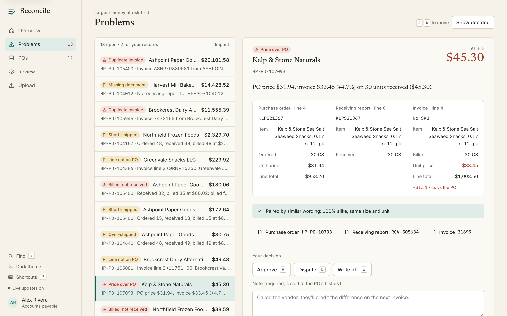
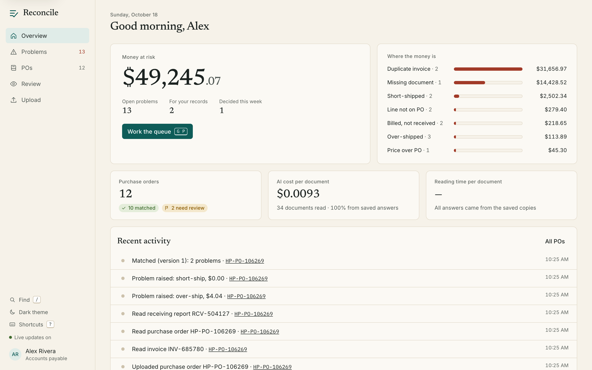
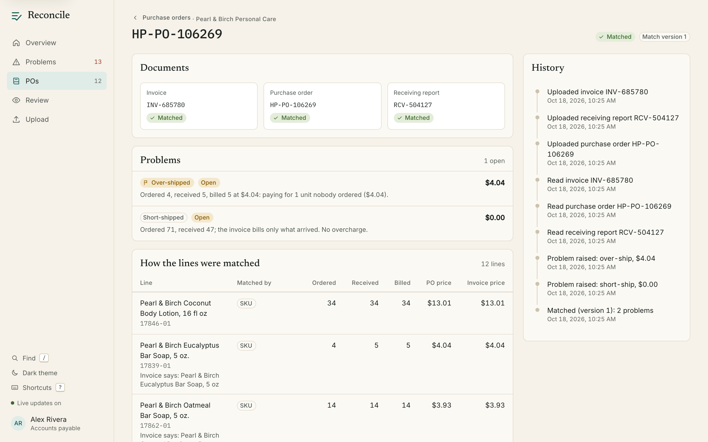
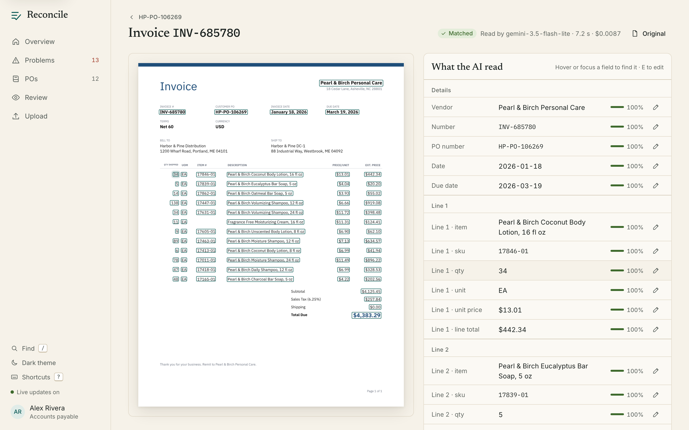
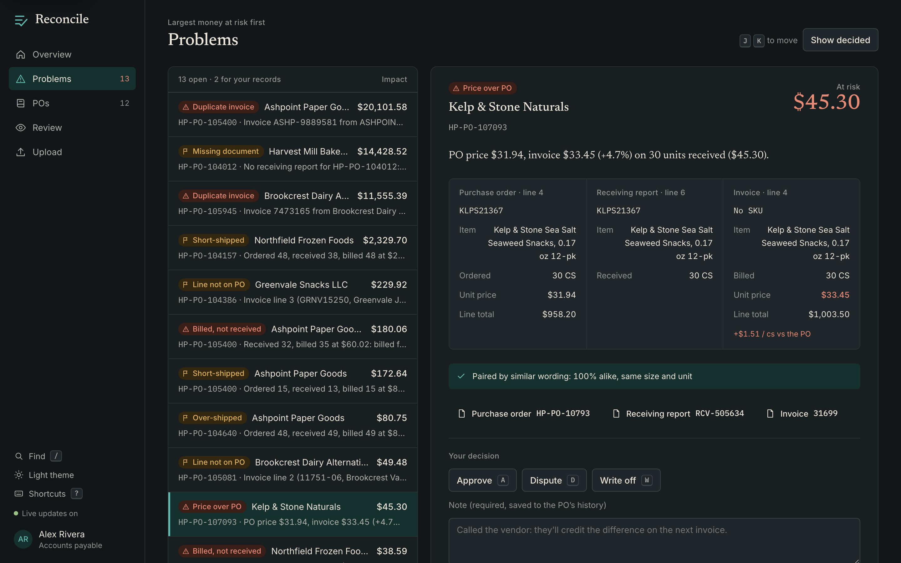

# Reconcile

An AI **3-way match** agent for distributors and CPG brands. It reconciles
**purchase orders**, **warehouse receiving reports**, and **supplier
invoices**, then flags short-ships, price mismatches, and other exceptions for
a human to approve, dispute, or write off.

> **Status: M6 released (v0.7.0): a working website and an AI-assistant connector.** Drop in documents and watch Reconcile read them
> with AI, file them under their PO, and match them, live. Work through the problems,
> costliest first, with the evidence side by side, and approve, dispute, or write off
> each one. Ask Claude about your POs through the AI-assistant connector (M6). Deployment (M7) comes next (see
> [the milestone list](docs/milestones/README.md)).



Everything runs locally for **$0**: Docker Compose (Postgres, Redis),
TypeScript end to end, and the Gemini free tier later on.

## Quickstart

Requirements: Node 24+, Docker. pnpm comes through Corepack, which ships with Node.

```bash
corepack enable
pnpm install
cp .env.example .env
docker compose up -d
pnpm db:migrate
pnpm db:seed
pnpm generate --sets 10 --out /tmp/reconcile-demo
```

If port 5432 is already taken on your machine, set `POSTGRES_PORT=5433` in
`.env` and change the port in both database URLs.

## The synthetic document generator

There are no real documents to work with, so the generator makes realistic
ones and **plants known mistakes** in them. Each document set comes with an
answer key (`ground_truth.json`). That gives demo data and a labeled
evaluation set at the same time.

```bash
pnpm generate --seed 42 --sets 100 --out evals/golden   # full golden set (not committed)
pnpm generate:ci                                        # rebuild the committed 20-set CI subset
pnpm generate:samples                                   # README thumbnails
```

| Option | Default | Meaning |
|---|---|---|
| `--seed` | `42` | Same seed gives byte-identical files |
| `--sets` | `100` | Number of document sets |
| `--out` | `evals/golden` | Output folder (old `S####` folders in it are replaced) |
| `--config` | none | JSON file overriding error rates, e.g. `{"errors": {"price_change": 0.5}}` |
| `--scan-rate` | `0.2` | Share of single-page documents output as PNG "scans" |

What a run looks like:

```
Planted errors
  short_ship_billed_full           10
  short_ship_billed_correctly       4
  over_ship                         7
  billed_not_received               9
  price_change                     15
  description_typo                 24
  sku_omitted                      12
  extra_invoice_line                7
  missing_document                  9
  ...
Documents
  clean sets      35
  documents      292
  PNG scans       60
Done in 18.6s
```

### What the documents look like

Purchase orders come from the buyer's ERP, and receiving reports from its
warehouse system. Invoices come in six vendor layouts, with different fonts,
column orders, header labels, and date formats.

| Purchase order | Receiving report | Invoice: classic | Invoice: modern |
|---|---|---|---|
|  |  |  |  |

| Invoice: ERP printout | Invoice: two-column | Invoice: boxed form | Invoice: letterhead |
|---|---|---|---|
|  |  |  |  |

About 20% of documents are output as "scans": slightly rotated, blurred,
grayscale, and noisy.

### The answer key

Each set folder holds the documents plus `ground_truth.json`, which is
validated by the Zod schema in `packages/core`. Excerpt from
`evals/golden-ci/S0010`:

```jsonc
{
  "poNumber": "HP-PO-104157",
  "documents": [
    { "file": "inv-1.pdf", "template": "twocol", "fields": {
        "lines": [{ "sku": { "value": "NR-19263", "page": 1, "bbox": [0.0882, 0.3103, 0.1539, 0.3232] },
                    "qty": { "value": 45, "page": 1, "bbox": [0.6173, 0.3103, 0.634, 0.3232] }, "...": "..." }],
        "total": { "value": "43453.15", "page": 1, "bbox": [0.832, 0.6616, 0.9118, 0.6753] } } }
  ],
  "lineMatches": [{ "po": "po:1", "rr": "rr:6", "inv": "inv-1:1" }],
  "exceptions": [
    { "type": "SHORT_SHIP", "lineKeys": ["po:7", "rr:8", "inv-1:7"], "amount": "2329.70", "informational": false }
  ],
  "planted": [
    { "type": "short_ship_billed_full", "details": { "ordered": 48, "received": 38, "billed": 48 } }
  ]
}
```

- **Every field has its location**: the page number, and a bounding box
  normalized to `[0,1]` with the origin at the top-left. Scans get rotated boxes.
- **Expected exceptions** follow [PRD FR-09](docs/prd.md), which counts each
  billed unit once. They're computed from the planted errors, never by running
  a matcher ([ADR-0008](docs/adr/0008-generator-truth-from-planted-errors.md)).
- **Honest caveat:** synthetic documents are cleaner than real ones. Varied
  layouts, scans, typos, and abbreviations narrow that gap but don't close it.

## Evals: how good is the matching?

`pnpm eval` runs the matcher on the answer keys' documents (all sets mixed into
one pile), compares its decisions with the answer keys, and prints a scoreboard:

```
Reconcile eval · stage: match · inputs: answer keys · subset: ci (20 sets, 60 docs)

  metric                  score  baseline   change
  grouping accuracy       100.0      100.0     +0.0
  link precision          100.0      100.0     +0.0
  link recall             100.0      100.0     +0.0
  exception precision     100.0      100.0     +0.0
  exception recall        100.0      100.0     +0.0
  amount accuracy         100.0      100.0     +0.0
  ...
  ✓ within 2 points of baseline
```

| Command | What it does |
|---|---|
| `pnpm eval` | Score the committed 20-set CI subset |
| `pnpm eval --subset full` | Score `evals/golden` (run `pnpm generate` first) |
| `pnpm eval --dir <folder>` | Score any generated folder |
| `pnpm eval --check-baseline` | Fail if any score drops more than 2 points (runs in CI on every PR) |
| `pnpm eval --update-baseline` | Save the current scores as the new baseline (commit it with a reason) |

Each run writes `evals/results/*.json` with every mistake and every
description-based pairing and its reason.

**Why 100?** In M2 the matcher receives *perfect* inputs (the answer keys'
values), so this measures the matching rules alone. Scores will drop once M3
reads real PDFs with an LLM, and that drop is exactly what the next milestone measures.

## The website

```bash
docker compose up -d && pnpm db:migrate && pnpm db:seed
pnpm dev:demo        # API, worker, and website, using the recorded AI answers (no key, no cost)
open http://localhost:3000
```

Then drag the files of a few test sets (folders in `evals/golden-ci/`) onto the **Upload**
page. `pnpm dev` does the same with the real AI (it needs `GEMINI_API_KEY` in `.env`).

| Page | What you do there |
|---|---|
| **Overview** | See the money at risk, where it is, PO counts, and what the AI costs per document |
| **Problems** | Work the queue, costliest first: the explanation, the lines from all three documents side by side, and a decision with a required note |
| **POs** | Each PO's documents, how every line was paired (by SKU, by similar wording, or by the AI with its reason), and its full history |
| **Document** | The original page with a box over every field the AI read, its confidence, and a pencil to correct a field (the PO re-matches by itself) |
| **Review** | Only the documents the AI wasn't sure about |
| **Upload** | Drop files and watch each one go *uploaded → reading → ready → matched*, live |

**Keyboard:** `J`/`K` next and previous, `A`/`D`/`W` approve, dispute, write off, `Enter` to
save, `E` to edit a field, `/` to find a PO, `G` then `O`/`P`/`L`/`R`/`U` to change pages,
`?` for all of them. There's a light and a dark theme.

| | |
|---|---|
|  |  |
|  |  |

The look ("Ledger": warm paper, ink, one teal accent) is written down in the
[style guide](docs/style-guide.md). The website talks only to the API, using types generated
from the API's own manual ([ADR-0012](docs/adr/0012-website-stack.md)), and live updates come
over server-sent events ([ADR-0013](docs/adr/0013-live-updates.md)).

**The one browser test** (`pnpm test:e2e`) starts the whole stack on its own ports and
database, uploads a test set, waits until it's matched, writes off the costliest problem by
keyboard, finds the decision in the PO's history, and checks every page for accessibility
problems in both themes. It runs in CI.

## Ask an AI assistant (MCP)

Reconcile includes a connector for AI assistants (an **MCP server**, `packages/mcp`), so you can ask
Claude about your purchase orders in plain words. It has six **read-only** tools: nothing an
assistant does through them can change Reconcile's data.

| Tool | Answers questions like |
|---|---|
| `list_exceptions` | "What's still open over $1,000?" |
| `explain_match` | "Why does HP-PO-104386 have a problem?" |
| `find_short_shipments` | "What was short-shipped in August 2026?" |
| `get_audit_trail` | "Who wrote off the problem on HP-PO-104386, and why?" |
| `get_overview` | "How are we doing this week?" |
| `find_purchase_orders` | "Which Greenvale POs need review?" |

**Claude Code, in this folder:** start the stack (`pnpm dev:demo`) and open Claude Code here. The
repo's `.mcp.json` offers the `reconcile` server; approve it when asked. Nothing else to set up.

**Claude Code, from any other folder:** add it once for your user (pick this *or* the `.mcp.json`
approval above, not both, or Claude Code warns about two servers with the same name):

```bash
claude mcp add --scope user reconcile -- node /path/to/reconcile/packages/mcp/bin/reconcile-mcp.mjs
```

**Claude Desktop:** add this to `claude_desktop_config.json` (Settings → Developer → Edit config).
Use full paths: Claude Desktop doesn't see your shell's `PATH`, so if you use nvm, put the output of
`which node` as the command.

```json
{
  "mcpServers": {
    "reconcile": {
      "command": "/full/path/to/node",
      "args": ["/path/to/reconcile/packages/mcp/bin/reconcile-mcp.mjs"]
    }
  }
}
```

The connector starts with plain Node (no pnpm), so it works from whatever folder the assistant
starts it in. The API must be running.

The connector reads through the API, the same way the website does, so the assistant and the website
always agree ([ADR-0014](docs/adr/0014-mcp-through-the-api.md)). Text that came from documents is
returned inside `«…»` and the assistant is told to treat it as data, never as instructions.

## Put it online (AWS, $0 on the Free plan)

Two commands put Reconcile on AWS at an HTTPS link you can share, and remove it again
([ADR-0015](docs/adr/0015-one-server-behind-cloudfront.md)). It's one small server running the same
containers as your laptop, behind CloudFront for HTTPS. The infrastructure is described in
[`infra/`](infra) with Terraform.

**What it costs:** about **$17.50 a month**, paid from the AWS Free plan's credits ($100 at sign-up,
up to $200). A Free-plan account **can't be charged**, so the credits cover the whole 6-month plan.
Two budget alarms email you: one on any real charge, one if credits are being used faster than
expected.

**One-time setup (yours: it involves your account and credentials):**

1. Create an AWS account at [aws.amazon.com](https://aws.amazon.com) and choose the **Free plan**.
2. Install the tools: `brew install awscli hashicorp/tap/terraform`. If Homebrew says your Command
   Line Tools are too old, update them first (`softwareupdate --list`, then install the "Command Line
   Tools for Xcode" entry with `sudo softwareupdate --install "<that label>"`).
3. Sign in from your terminal: `aws login` (or `aws configure sso`). Terraform uses that sign-in; no
   keys go in this repo, in chat, or in any file.

**Deploy, then remove:**

```bash
pnpm deploy:up      # shows the plan, asks you to confirm, deploys, smoke-tests, prints the link
pnpm deploy:down    # deletes everything, then checks nothing billable is left
```

`deploy:up` deploys the current commit, which must be pushed to GitHub (the server builds from
there). The first run takes about 20 minutes (server setup, image build, and CloudFront); later runs
only rebuild the app. It asks once for the email address for the budget alarms.

**On the live site:** anyone with the link can look around. Uploading, deciding, and correcting need
the **demo password** that `deploy:up` prints (the **Unlock changes** button,
[ADR-0016](docs/adr/0016-demo-password-for-changes.md)). The AI uses recorded answers only, so it
reads the sample documents; other files get a "demo mode" message. No AI key is stored in AWS.

| Command | What it does |
|---|---|
| `pnpm deploy:smoke` | Run the live smoke test against the deployed site |
| `pnpm deploy:leftovers` | Check nothing tagged `Project=reconcile` is left in your account |
| `aws ssm start-session --target <instance id>` | A terminal on the server (no SSH port is open) |

## Running Reconcile as a service

```bash
docker compose up -d && pnpm db:migrate && pnpm db:seed
pnpm dev                                   # starts the API (port 3001) and the background worker
curl -F file=@evals/golden-ci/S0010/po.pdf localhost:3001/documents
curl -F file=@evals/golden-ci/S0010/rr.pdf localhost:3001/documents
curl -F file=@evals/golden-ci/S0010/inv-1.pdf localhost:3001/documents
curl localhost:3001/sets/HP-PO-104157     # a few seconds later: matched, with its problems explained
open http://localhost:3001/docs            # the live manual: every address, with a "try it" button
```

To try it **without an API key or quota**, add `LLM_MODE=replay` and
`LLM_ANSWER_CACHE_DIR=evals/cache` to `.env`. The worker then uses the recorded AI
answers for the test documents.

**How it works:** the API saves your file and adds a "read this" job to a to-do list
(a queue in Redis). The worker picks it up, reads the document with the AI, files it
under its PO, and matches the PO once it has its documents. Some details:
- **Same file twice?** Recognized by its fingerprint and not processed again.
- **Missing a document?** Reconcile waits 7 days before saying so, because documents often arrive days apart.
- **Unsure reading, or a PO number that looks misread?** The PO is still matched but labeled **provisional, needs review**, with a note.
- **Re-matching** creates a new version, and a decision on a problem carries over to the same problem.

| Address | What you get |
|---|---|
| `POST /documents` | Upload a PDF, PNG, or JPEG (form field `file`, max 10 MB) |
| `GET /documents`, `/documents/:id`, `/documents/:id/file` | Documents, what the AI read and how sure it was, the original file |
| `GET /sets`, `/sets/:poNumber` | Each PO's status, line matches (with the AI's reasons), problems, notes |
| `GET /exceptions`, `/exceptions/:id` | Current problems (sortable by impact); one problem with its lines side by side |
| `POST /exceptions/:id/decision` | Approve, dispute, or write off, with a required note |
| `POST /documents/:id/corrections` | Fix fields the AI misread; saves a human version and re-matches the PO |
| `GET /documents/:id/pages/:n` | A page as an image, for the highlight viewer |
| `GET /sets/:poNumber/history`, `/overview`, `/review` | A PO's history in plain sentences, the overview numbers, documents to review |
| `GET /short-shipments` | Lines where less arrived than was ordered, by receiving date |
| `GET /events` | Live feed of changes (server-sent events) |
| `GET /health`, `/docs` | Health check, live manual |

## Reading documents with an LLM

```bash
# one-time: get a free Gemini key at aistudio.google.com and add GEMINI_API_KEY=… to .env
pnpm extract evals/golden-ci/S0010/inv-1.pdf
```

```
inv-1.pdf · 1 page(s) · gemini/gemini-3.5-flash-lite
  INVOICE  INV-967018 (conf 1.00)  vendor: Northfield Frozen Foods  date: 2026-03-26  PO: HP-PO-104157
  #  SKU        description                                   qty    price       total  min conf
  1  NR-19263   Northfield Steak Fajita Frozen Burrito, 6 oz   45  $243.24  $10,945.80  1.00
  …
  ✓ no review needed
  tokens 1575 in / 3333 out · $0.00881 · 7193 ms
```

- **Providers:** `LLM_PROVIDER=gemini|groq|openai|anthropic|ollama` via LangChain.js. Our own
  layer adds a response cache, rate and token limits, retries, a hard spend cap for paid
  providers, and a call log ([ADR-0010](docs/adr/0010-langchain-provider-switching.md)).
- **Trust, but verify:** every field has a confidence and a location. Math checks (qty × price,
  line sum, totals) lower confidence on failure. When the lines don't add up to the printed
  subtotal, extraction asks once more with the evidence (self-check). Anything doubtful is
  flagged for review.

### Eval stages

| Stage | What it measures | CI subset, `gemini-3.5-flash-lite` |
|---|---|---|
| `match` | Matching on perfect inputs (hybrid line pairing) | 100 on every metric |
| `extract` | Reading accuracy (fields vs the answer key) | **F1 99.8** (PDF 99.9, scans 99.5) |
| `e2e` | Reading → matching → exceptions | **100** on every metric |

```bash
pnpm eval --stage all            # replays recorded answers in evals/cache: no key, no cost
pnpm eval:record                 # live: records new answers (cached, rate-limited, capped)
```

In M3 the gap between `match` and `e2e` came from one confidently misread PO number. M4
groups a PO number that's one character off with the same vendor's PO, and labels it for
review, which closed the gap.

### Does the AI matcher earn its place?

Some invoices describe products in the vendor's own words ("Chunky Nut Spread, Almond, 12 oz"
for "Sunpeak Crunchy Almond Butter, 12 oz"), with no SKU. `pnpm eval --fuzzy text|llm|hybrid`
compares three ways of pairing such lines:

| Pairing | CI subset (exception precision) | 200 stress sets | AI calls |
|---|---|---|---|
| `text` (word similarity) | 89.5 | 96.8 | 0 |
| `llm` (AI only) | 100 | not run (daily quota) | 3 on CI |
| **`hybrid`** (text first, AI for the rest) | **100** | **98.3** | 1 on CI, 2 on stress |

Hybrid is the default: the AI only sees the lines the word matcher couldn't pair
confidently, and it explains every pair it makes.

## Repository layout

```
packages/core        Zod schemas (answer key, money, enums), env loader
packages/db          Prisma schema + migrations, append-only audit log, seed
packages/generator   Synthetic PO / RR / invoice generator
packages/core        + matching engine: grouping, line pairing, FR-09 exceptions
packages/llm         LLM client: LangChain providers + cache, limits, budget, call log
packages/pipeline    Shared by API + worker: storage, upload, read a document, match a PO, history log
apps/api             The upload/results service (Fastify) with a live manual at /docs
apps/worker          The background helper: read and match jobs (BullMQ on Redis)
apps/web             The website (Next.js): overview, problems, POs, documents, review, upload
packages/api-client  The typed API client shared by the website and the MCP server
packages/mcp         The AI-assistant connector (MCP server): six read-only tools
infra/               Terraform for the AWS deploy (server, CloudFront, secrets, budgets)
deploy/              Production image, containers, Caddy, and the server's update script
packages/extraction  PDF/scan → typed document with confidence, checks, review flag
evals/               Eval harness (pnpm eval), baseline.json, committed 20-set CI subset
docs/                PRD, architecture, ADRs, milestone docs, learning log
```

## Commands

| Command | What it does |
|---|---|
| `pnpm lint` / `pnpm typecheck` / `pnpm test` | Quality checks (DB tests need `DATABASE_URL_TEST`) |
| `pnpm format` | Prettier |
| `pnpm db:migrate` / `db:seed` / `db:reset` | Database |
| `pnpm docs:diagrams` | Re-render Mermaid diagrams to PNG after editing them |
| `pnpm docs:check` | Check links and diagram freshness (runs in CI) |
| `pnpm eval` | Score match / extract / e2e against the answer keys (see above) |
| `pnpm extract <file>` | Read one document with the LLM |
| `pnpm dev` | Start the API, the worker, and the website together |
| `pnpm dev:demo` | The same, on the recorded AI answers (no key, no cost) |
| `pnpm test:e2e` | The browser test (Playwright, with accessibility checks) |
| `pnpm mcp` | Start the AI-assistant connector (assistants run this for you) |
| `pnpm deploy:up` / `deploy:down` | Put it on AWS / remove it (see "Put it online") |

## How this project is built

The project follows a gated SDLC: requirements → design → implementation →
testing → review → release → retrospective, with a written artifact at each
step. Start with the [PRD](docs/prd.md), the [architecture](docs/architecture.md),
and the [learning log](docs/learning-log.md).
