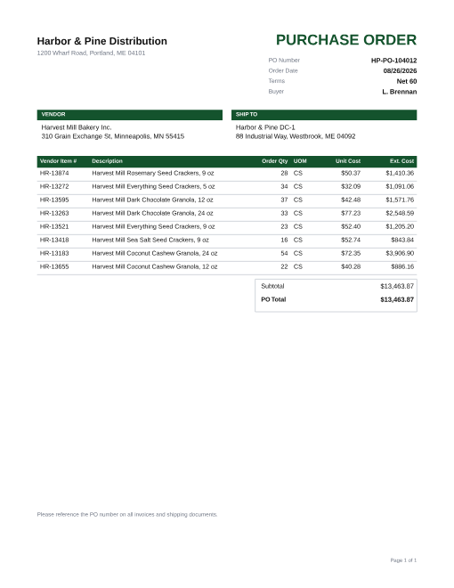
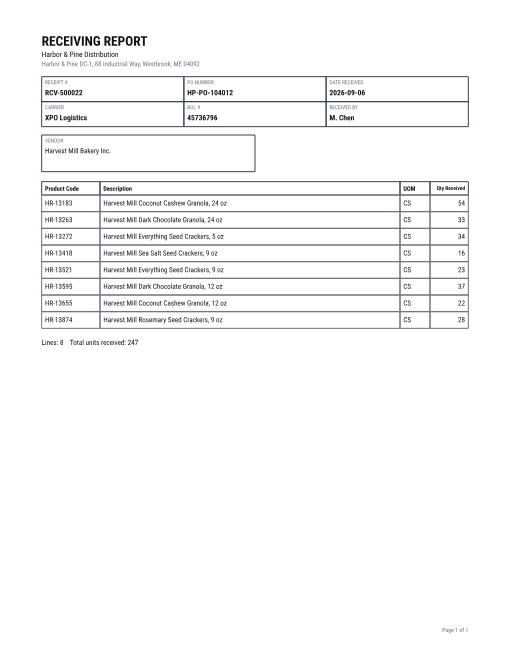
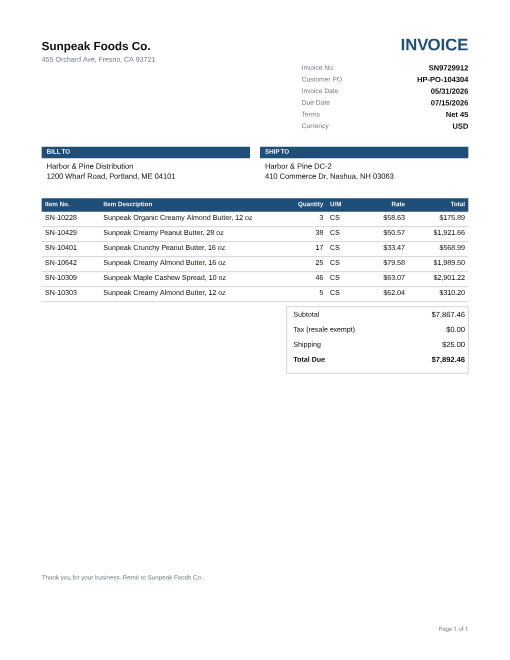
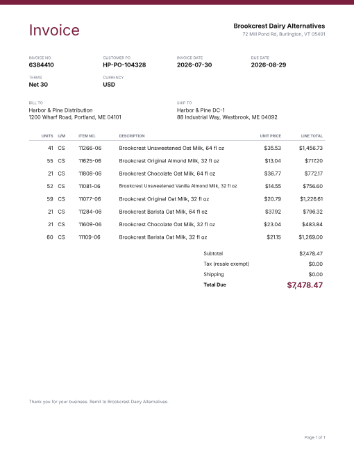
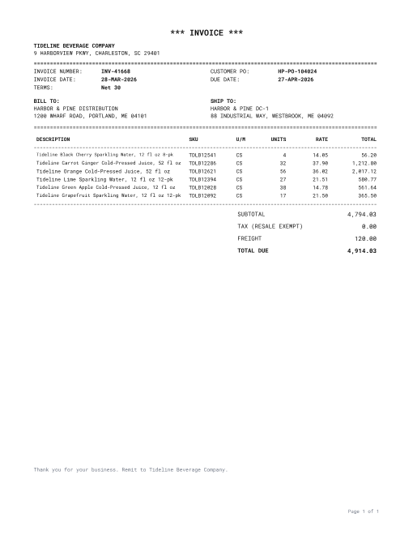
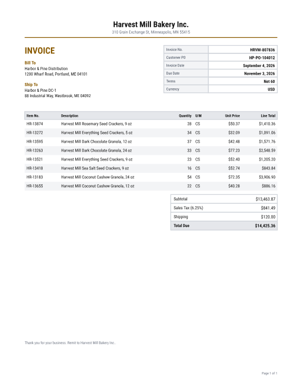
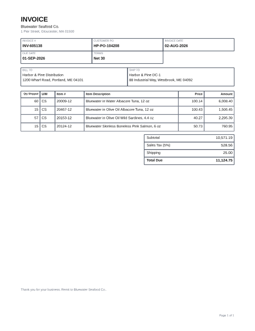
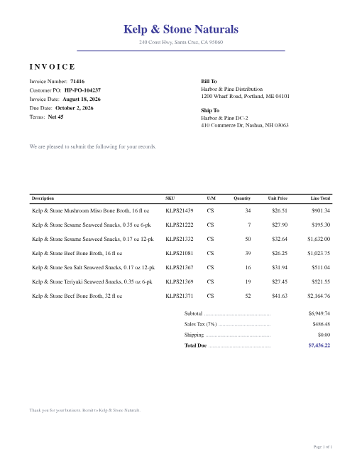

# Reconcile

An AI **3-way match** agent for distributors and CPG brands. It reconciles
**purchase orders**, **warehouse receiving reports**, and **supplier
invoices**, then flags short-ships, price mismatches, and other exceptions for
a human to approve, dispute, or write off.

> **Status: M4, a running backend.** Upload a document and Reconcile reads it with
> AI, files it under its PO, matches the set, and serves the results through an API,
> all in the background. The website (M5) and the AI-assistant connector (M6)
> come next (see [the milestone list](docs/milestones/README.md)).

Everything runs locally for **$0**: Docker Compose (Postgres, Redis),
TypeScript end to end, and the Gemini free tier later on.

## Quickstart

Requirements: Node 24+, Docker. pnpm comes through Corepack, which ships with Node.

```bash
corepack enable
pnpm install
cp .env.example .env
docker compose up -d
pnpm db:migrate
pnpm db:seed
pnpm generate --sets 10 --out /tmp/reconcile-demo
```

If port 5432 is already taken on your machine, set `POSTGRES_PORT=5433` in
`.env` and change the port in both database URLs.

## The synthetic document generator

There are no real documents to work with, so the generator makes realistic
ones and **plants known mistakes** in them. Each document set comes with an
answer key (`ground_truth.json`). That gives demo data and a labeled
evaluation set at the same time.

```bash
pnpm generate --seed 42 --sets 100 --out evals/golden   # full golden set (not committed)
pnpm generate:ci                                        # rebuild the committed 20-set CI subset
pnpm generate:samples                                   # README thumbnails
```

| Option | Default | Meaning |
|---|---|---|
| `--seed` | `42` | Same seed gives byte-identical files |
| `--sets` | `100` | Number of document sets |
| `--out` | `evals/golden` | Output folder (old `S####` folders in it are replaced) |
| `--config` | none | JSON file overriding error rates, e.g. `{"errors": {"price_change": 0.5}}` |
| `--scan-rate` | `0.2` | Share of single-page documents output as PNG "scans" |

What a run looks like:

```
Planted errors
  short_ship_billed_full           10
  short_ship_billed_correctly       4
  over_ship                         7
  billed_not_received               9
  price_change                     15
  description_typo                 24
  sku_omitted                      12
  extra_invoice_line                7
  missing_document                  9
  ...
Documents
  clean sets      35
  documents      292
  PNG scans       60
Done in 18.6s
```

### What the documents look like

Purchase orders come from the buyer's ERP, and receiving reports from its
warehouse system. Invoices come in six vendor layouts, with different fonts,
column orders, header labels, and date formats.

| Purchase order | Receiving report | Invoice: classic | Invoice: modern |
|---|---|---|---|
|  |  |  |  |

| Invoice: ERP printout | Invoice: two-column | Invoice: boxed form | Invoice: letterhead |
|---|---|---|---|
|  |  |  |  |

About 20% of documents are output as "scans": slightly rotated, blurred,
grayscale, and noisy.

### The answer key

Each set folder holds the documents plus `ground_truth.json`, which is
validated by the Zod schema in `packages/core`. Excerpt from
`evals/golden-ci/S0010`:

```jsonc
{
  "poNumber": "HP-PO-104157",
  "documents": [
    { "file": "inv-1.pdf", "template": "twocol", "fields": {
        "lines": [{ "sku": { "value": "NR-19263", "page": 1, "bbox": [0.0882, 0.3103, 0.1539, 0.3232] },
                    "qty": { "value": 45, "page": 1, "bbox": [0.6173, 0.3103, 0.634, 0.3232] }, "...": "..." }],
        "total": { "value": "43453.15", "page": 1, "bbox": [0.832, 0.6616, 0.9118, 0.6753] } } }
  ],
  "lineMatches": [{ "po": "po:1", "rr": "rr:6", "inv": "inv-1:1" }],
  "exceptions": [
    { "type": "SHORT_SHIP", "lineKeys": ["po:7", "rr:8", "inv-1:7"], "amount": "2329.70", "informational": false }
  ],
  "planted": [
    { "type": "short_ship_billed_full", "details": { "ordered": 48, "received": 38, "billed": 48 } }
  ]
}
```

- **Every field has its location**: the page number, and a bounding box
  normalized to `[0,1]` with the origin at the top-left. Scans get rotated boxes.
- **Expected exceptions** follow [PRD FR-09](docs/prd.md), which counts each
  billed unit once. They're computed from the planted errors, never by running
  a matcher ([ADR-0008](docs/adr/0008-generator-truth-from-planted-errors.md)).
- **Honest caveat:** synthetic documents are cleaner than real ones. Varied
  layouts, scans, typos, and abbreviations narrow that gap but don't close it.

## Evals: how good is the matching?

`pnpm eval` runs the matcher on the answer keys' documents (all sets mixed into
one pile), compares its decisions with the answer keys, and prints a scoreboard:

```
Reconcile eval · stage: match · inputs: answer keys · subset: ci (20 sets, 60 docs)

  metric                  score  baseline   change
  grouping accuracy       100.0      100.0     +0.0
  link precision          100.0      100.0     +0.0
  link recall             100.0      100.0     +0.0
  exception precision     100.0      100.0     +0.0
  exception recall        100.0      100.0     +0.0
  amount accuracy         100.0      100.0     +0.0
  ...
  ✓ within 2 points of baseline
```

| Command | What it does |
|---|---|
| `pnpm eval` | Score the committed 20-set CI subset |
| `pnpm eval --subset full` | Score `evals/golden` (run `pnpm generate` first) |
| `pnpm eval --dir <folder>` | Score any generated folder |
| `pnpm eval --check-baseline` | Fail if any score drops more than 2 points (runs in CI on every PR) |
| `pnpm eval --update-baseline` | Save the current scores as the new baseline (commit it with a reason) |

Each run writes `evals/results/*.json` with every mistake and every
description-based pairing and its reason.

**Why 100?** In M2 the matcher receives *perfect* inputs (the answer keys'
values), so this measures the matching rules alone. Scores will drop once M3
reads real PDFs with an LLM, and that drop is exactly what the next milestone measures.

## Running Reconcile as a service

```bash
docker compose up -d && pnpm db:migrate && pnpm db:seed
pnpm dev                                   # starts the API (port 3001) and the background worker
curl -F file=@evals/golden-ci/S0010/po.pdf localhost:3001/documents
curl -F file=@evals/golden-ci/S0010/rr.pdf localhost:3001/documents
curl -F file=@evals/golden-ci/S0010/inv-1.pdf localhost:3001/documents
curl localhost:3001/sets/HP-PO-104157     # a few seconds later: matched, with its problems explained
open http://localhost:3001/docs            # the live manual: every address, with a "try it" button
```

To try it **without an API key or quota**, add `LLM_MODE=replay` and
`LLM_ANSWER_CACHE_DIR=evals/cache` to `.env`. The worker then uses the recorded AI
answers for the test documents.

**How it works:** the API saves your file and adds a "read this" job to a to-do list
(a queue in Redis). The worker picks it up, reads the document with the AI, files it
under its PO, and matches the PO once it has its documents. Some details:
- **Same file twice?** Recognized by its fingerprint and not processed again.
- **Missing a document?** Reconcile waits 7 days before saying so, because documents often arrive days apart.
- **Unsure reading, or a PO number that looks misread?** The PO is still matched but labeled **provisional, needs review**, with a note.
- **Re-matching** creates a new version, and a decision on a problem carries over to the same problem.

| Address | What you get |
|---|---|
| `POST /documents` | Upload a PDF, PNG, or JPEG (form field `file`, max 10 MB) |
| `GET /documents`, `/documents/:id`, `/documents/:id/file` | Documents, what the AI read and how sure it was, the original file |
| `GET /sets`, `/sets/:poNumber` | Each PO's status, line matches (with the AI's reasons), problems, notes |
| `GET /exceptions`, `/exceptions/:id` | Current problems, filterable by type, status, PO |
| `GET /health`, `/docs` | Health check, live manual |

## Reading documents with an LLM

```bash
# one-time: get a free Gemini key at aistudio.google.com and add GEMINI_API_KEY=… to .env
pnpm extract evals/golden-ci/S0010/inv-1.pdf
```

```
inv-1.pdf · 1 page(s) · gemini/gemini-3.5-flash-lite
  INVOICE  INV-967018 (conf 1.00)  vendor: Northfield Frozen Foods  date: 2026-03-26  PO: HP-PO-104157
  #  SKU        description                                   qty    price       total  min conf
  1  NR-19263   Northfield Steak Fajita Frozen Burrito, 6 oz   45  $243.24  $10,945.80  1.00
  …
  ✓ no review needed
  tokens 1575 in / 3333 out · $0.00881 · 7193 ms
```

- **Providers:** `LLM_PROVIDER=gemini|groq|openai|anthropic|ollama` via LangChain.js. Our own
  layer adds a response cache, rate and token limits, retries, a hard spend cap for paid
  providers, and a call log ([ADR-0010](docs/adr/0010-langchain-provider-switching.md)).
- **Trust, but verify:** every field has a confidence and a location. Math checks (qty × price,
  line sum, totals) lower confidence on failure. When the lines don't add up to the printed
  subtotal, extraction asks once more with the evidence (self-check). Anything doubtful is
  flagged for review.

### Eval stages

| Stage | What it measures | CI subset, `gemini-3.5-flash-lite` |
|---|---|---|
| `match` | Matching on perfect inputs (hybrid line pairing) | 100 on every metric |
| `extract` | Reading accuracy (fields vs the answer key) | **F1 99.8** (PDF 99.9, scans 99.5) |
| `e2e` | Reading → matching → exceptions | **100** on every metric |

```bash
pnpm eval --stage all            # replays recorded answers in evals/cache: no key, no cost
pnpm eval:record                 # live: records new answers (cached, rate-limited, capped)
```

In M3 the gap between `match` and `e2e` came from one confidently misread PO number. M4
groups a PO number that's one character off with the same vendor's PO, and labels it for
review, which closed the gap.

### Does the AI matcher earn its place?

Some invoices describe products in the vendor's own words ("Chunky Nut Spread, Almond, 12 oz"
for "Sunpeak Crunchy Almond Butter, 12 oz"), with no SKU. `pnpm eval --fuzzy text|llm|hybrid`
compares three ways of pairing such lines:

| Pairing | CI subset (exception precision) | 200 stress sets | AI calls |
|---|---|---|---|
| `text` (word similarity) | 89.5 | 96.8 | 0 |
| `llm` (AI only) | 100 | not run (daily quota) | 3 on CI |
| **`hybrid`** (text first, AI for the rest) | **100** | **98.3** | 1 on CI, 2 on stress |

Hybrid is the default: the AI only sees the lines the word matcher couldn't pair
confidently, and it explains every pair it makes.

## Repository layout

```
packages/core        Zod schemas (answer key, money, enums), env loader
packages/db          Prisma schema + migrations, append-only audit log, seed
packages/generator   Synthetic PO / RR / invoice generator
packages/core        + matching engine: grouping, line pairing, FR-09 exceptions
packages/llm         LLM client: LangChain providers + cache, limits, budget, call log
packages/pipeline    Shared by API + worker: storage, upload, read a document, match a PO, history log
apps/api             The upload/results service (Fastify) with a live manual at /docs
apps/worker          The background helper: read and match jobs (BullMQ on Redis)
packages/extraction  PDF/scan → typed document with confidence, checks, review flag
evals/               Eval harness (pnpm eval), baseline.json, committed 20-set CI subset
docs/                PRD, architecture, ADRs, milestone docs, learning log
```

## Commands

| Command | What it does |
|---|---|
| `pnpm lint` / `pnpm typecheck` / `pnpm test` | Quality checks (DB tests need `DATABASE_URL_TEST`) |
| `pnpm format` | Prettier |
| `pnpm db:migrate` / `db:seed` / `db:reset` | Database |
| `pnpm docs:diagrams` | Re-render Mermaid diagrams to PNG after editing them |
| `pnpm docs:check` | Check links and diagram freshness (runs in CI) |
| `pnpm eval` | Score match / extract / e2e against the answer keys (see above) |
| `pnpm extract <file>` | Read one document with the LLM |
| `pnpm dev` | Start the API and the worker together |

## How this project is built

The project follows a gated SDLC: requirements → design → implementation →
testing → review → release → retrospective, with a written artifact at each
step. Start with the [PRD](docs/prd.md), the [architecture](docs/architecture.md),
and the [learning log](docs/learning-log.md).
