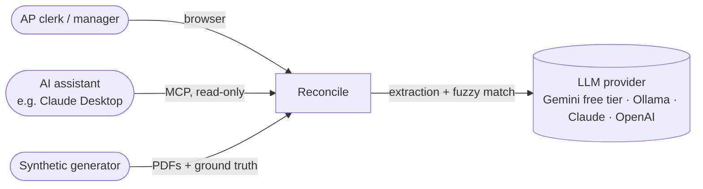
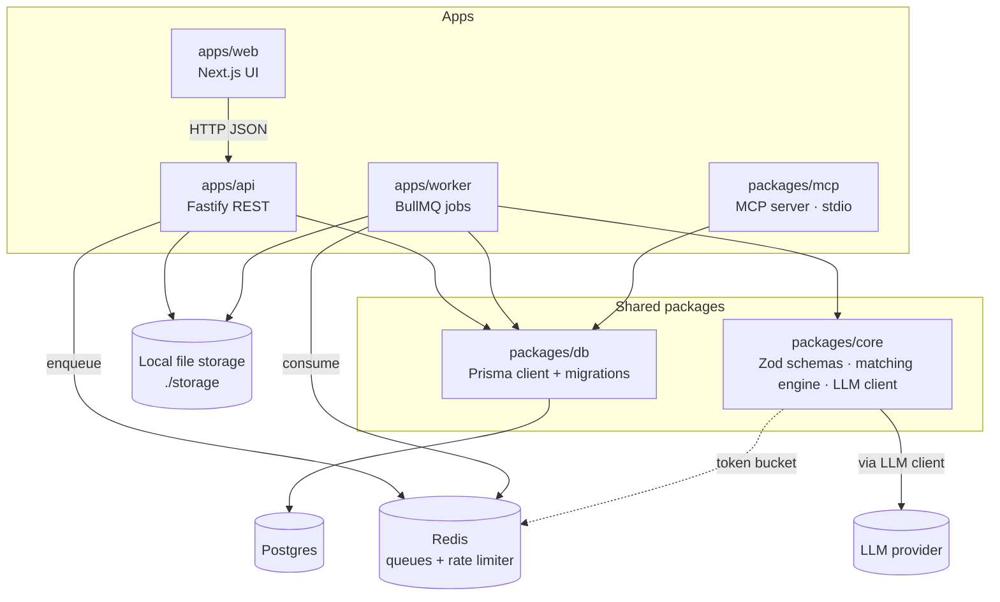
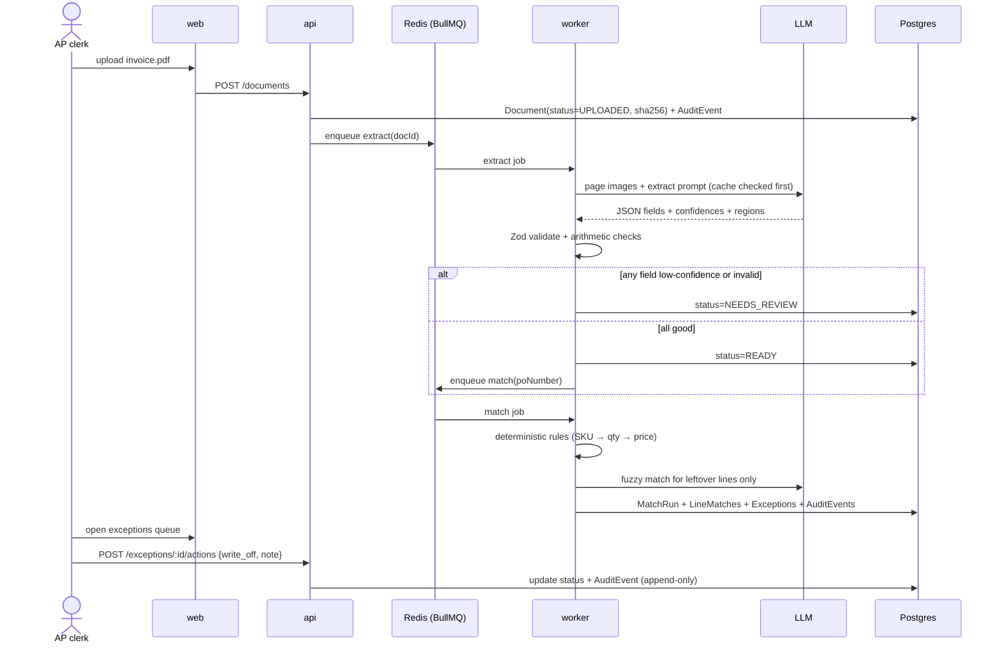
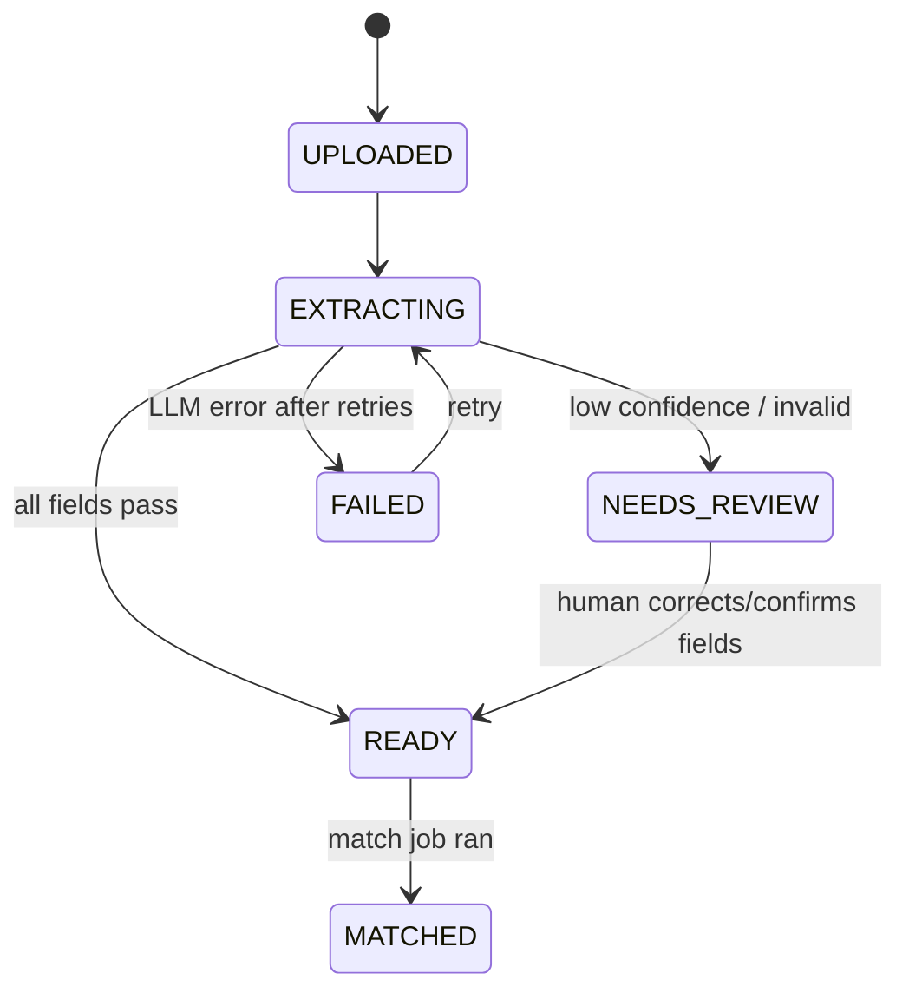
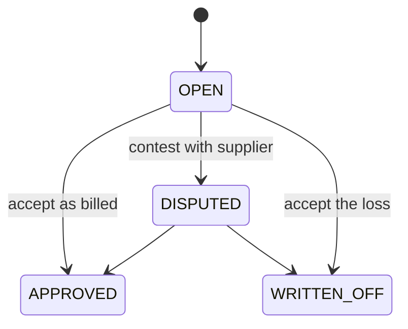
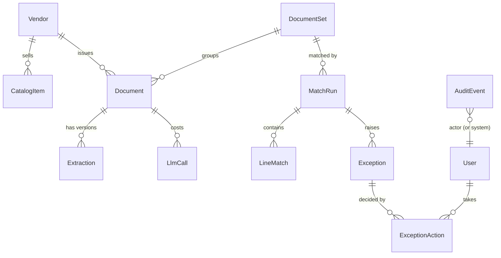
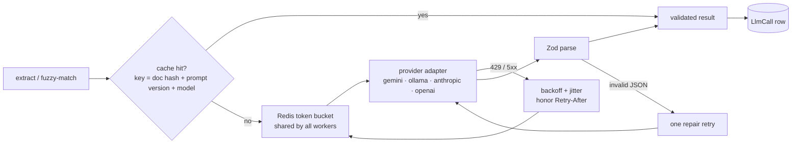
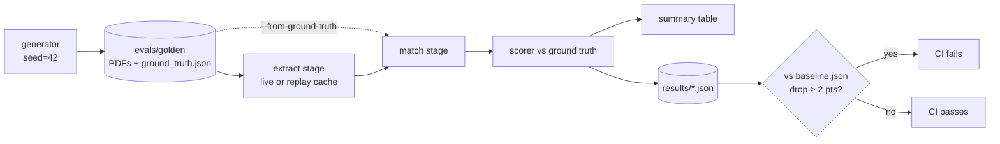

# Architecture

| | |
|---|---|
| Status | **Approved** at the M0 Design gate (2026-10-16) |
| Last updated | 2026-10-16 |
| Requirements | [`prd.md`](prd.md) |
| Decisions | [`adr/`](adr/) |

This page shows **how** Reconcile is built. Diagrams are Mermaid (they render
on GitHub). Detailed per-milestone designs live in `milestones/Mx/design.md`
and must stay consistent with this page, or update it.

## 1. System context: who talks to Reconcile

Everything except the LLM provider runs on your machine. With Ollama, the
LLM runs locally too.

## 2. Containers: the moving parts

| Part | Responsibility | Must NOT |
|---|---|---|
| `web` | UI only. Talks to `api` over HTTP. | touch the DB or queues directly |
| `api` | Validate requests, store files, write DB rows, enqueue jobs, record audit events | call the LLM (that's slow, so it belongs in the worker) |
| `worker` | Run the extract and match jobs | serve HTTP |
| `core` | Pure logic: schemas, matching, LLM client, prompts | import Prisma, Fastify, Next, or BullMQ |
| `db` | Schema, migrations, seed, typed client | contain business rules |
| `mcp` | Read-only tools over the DB | write anything |

## 3. Main flow: upload → exception

## 4. Lifecycles (state machines)

**Document**

**Exception**

Every arrow writes an `AuditEvent`. Informational exceptions (e.g. a
correctly billed short-ship) start `OPEN` but are excluded from the default
queue view.

## 5. Data model (overview)

Key design points:
- **`DocumentSet`** = everything sharing a PO number. It's created when the
  first doc for that PO arrives, so a set can be incomplete (`MISSING_DOCUMENT`).
- **`Extraction` is versioned.** Re-extracting with a new prompt adds a row and
  never overwrites. Human corrections are stored as a new version with
  `source=HUMAN`.
- **`MatchRun` is versioned.** Re-matching creates a new run. Each exception
  has a **fingerprint** (type + PO + line keys), so a human decision on an
  exception carries over to the same exception in later runs instead of being lost.
- **`AuditEvent`** is append-only. A DB trigger rejects UPDATE and DELETE (ADR-0005).
- **`LlmCall`** has one row per LLM request, including cache hits (ADR-0002).
- Money columns are `Decimal(14,4)` (ADR-0004).

## 6. LLM client (inside `core`)

Details are in ADR-0002. The provider is chosen by `LLM_PROVIDER`, and models
by `LLM_MODEL_EXTRACT` and `LLM_MODEL_MATCH`.

## 7. Matching engine (inside `core`)

A **pure function**: `match(set, config) → { lineMatches, exceptions }`. No
I/O, so it's easy to unit-test and evaluate. The fuzzy step is injected as a
function, so tests can stub it.

1. Check that the set has a PO, an RR, and an invoice. If one is missing past
   the grace period → `MISSING_DOCUMENT`.
2. Detect duplicate invoices → `DUPLICATE_INVOICE`.
3. Pair lines by normalized SKU.
4. Leftover lines → fuzzy matcher (LLM) → accept above a confidence
   threshold, keeping the reasoning. Still unpaired → `UNMATCHED_LINE`.
5. For each paired line, compare quantities and prices with tolerances →
   `SHORT_SHIP` / `OVER_SHIP` / `QTY_BILLED_NOT_RECEIVED` / `PRICE_VARIANCE`,
   each with a dollar impact and a generated explanation.

Details are in ADR-0003.

## 8. Evals pipeline

Details are in ADR-0006.

## 9. Deployment views

**Local (M1–M6):** `docker compose up -d` starts Postgres and Redis.
`pnpm dev` runs web, api, and worker on the host. File uploads go to `./storage`.

**Cloud (M7):** a single small EC2 instance runs the same compose stack, with
Terraform-managed networking and a budget alarm. That design is written at M7.

## 10. Cross-cutting concerns

| Concern | Approach |
|---|---|
| Config | Env validated by Zod at startup. `.env.example` lists every var. |
| Errors | Typed errors in `core`. The API maps them to RFC 7807 problem JSON. Jobs retry with backoff, then go to `FAILED`. |
| Idempotency | Extract jobs are keyed by `sha256 + promptVersion`, match jobs by `poNumber`. Re-running is safe. |
| Logging | Structured JSON logs (pino) with request/job ids |
| Security | Single seeded user. File type and size checks on upload. MCP is read-only. Secrets only in `.env`. |
| Testing | Unit tests next to the code (Vitest). One Playwright E2E. Evals are their own suite. |
