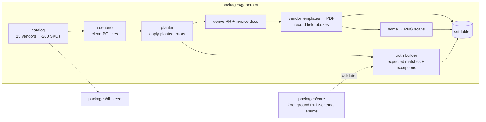

# M1: Foundation and synthetic data. Design

- **Status:** Approved (2026-10-16)
- **Implements:** AC-1 … AC-19 from [`requirements.md`](requirements.md)
- **New ADRs:** [0007](../../adr/0007-pdf-rendering-and-scans.md),
  [0008](../../adr/0008-generator-truth-from-planted-errors.md)

## 1. Overview


<details><summary>Diagram source (Mermaid)</summary>



</details>

There are three workstreams, built in this order on the branch:
**(A) repo and tooling → (B) database → (C) generator**, followed by docs (D).

## 2. Toolchain (pinned versions)

| Tool | Version | Why this one |
|---|---|---|
| Node | 24 LTS (local: 24.11.1) | Current LTS |
| pnpm | 10.34.x via Corepack (`packageManager` field) | Corepack ships with Node 24, so there's no global install. pnpm isn't installed on your machine yet, and `corepack enable` fixes that. |
| TypeScript | **6.0.x**, not 7 | typescript-eslint supports TS `< 6.1`. TS 7 (the native port) would break linting. |
| ESLint | 10 + typescript-eslint 8 | Flat config |
| Vitest | 5 | Unit and DB tests, one workspace config |
| Prisma | **7.10.x stable** | npm's `latest` tag currently points at an 8.0 RC, so we don't follow it. Uses `prisma.config.ts` and the `@prisma/adapter-pg` driver adapter. |
| Zod 4, decimal.js 10, tsx 4 | latest stable | |
| Postgres 17, Redis 8 | Docker images, pinned majors | Redis isn't used until M3/M4 but is started now, as planned |

**Internal packages ship TypeScript source** (`"exports": "./src/index.ts"`),
with no build step. tsx, Vitest, and later Next.js (`transpilePackages`) all
consume TS directly. This keeps the monorepo simple. Typecheck runs
`tsc --noEmit` per package. **No Turborepo** for now: plain `pnpm -r` is enough
for 3 packages (YAGNI). We'll revisit in M4 if builds get slow.

## 3. Repo layout after M1

```
.github/workflows/ci.yml
docker-compose.yml            postgres:17, redis:8 (healthchecks, named volumes)
package.json                  root scripts: lint, typecheck, test, generate, db:*
pnpm-workspace.yaml           packages/*, evals
tsconfig.base.json            strict, noUncheckedIndexedAccess, ESM
eslint.config.js              includes the core import restriction (ADR-0001)
vitest.workspace.ts
scripts/check-docs.ts         link check + diagram freshness check (B-10)
scripts/render-diagrams.ts    `pnpm docs:diagrams`: Mermaid → PNG + manifest
packages/core/                schemas/ (groundTruth, enums, money), env.ts
packages/db/                  prisma/schema.prisma, migrations/, seed.ts, test/
packages/generator/           catalog/, templates/, planter/, truth/, render/, scan/, cli.ts
packages/generator/assets/fonts/   OFL fonts (see §6.4)
evals/ci-subset.json          the 20 committed set IDs
evals/golden-ci/              committed CI subset
```

## 4. Workstream A: tooling and CI

- **Root scripts:** `lint`, `typecheck`, `test` (`pnpm -r`), `generate`
  (`tsx packages/generator/src/cli.ts`), `db:migrate`, `db:seed`, `db:reset`,
  `docs:check`.
- **Env (AC-5):** `packages/core/src/env.ts` exports `loadEnv(schema)`.
  Each package declares only what it uses. In M1 that's `DATABASE_URL` and
  `DATABASE_URL_TEST`. `.env.example` is committed.
- **CI (AC-4):** a single workflow on `pull_request` and `push: main`.
  - Job `check`: install (pnpm cache) → lint → typecheck → `docs:check`.
  - Job `test`: a Postgres 17 service container → `prisma migrate deploy` → `pnpm test`.
- **Diagrams as images:** Markdown viewers outside GitHub don't render Mermaid.
  So every diagram is committed as a **PNG** next to its source (kept in a
  collapsed `<details>` block). `pnpm docs:diagrams` renders the PNGs with
  `@mermaid-js/mermaid-cli` (a dev dependency) and writes
  `docs/diagrams/manifest.json`, which maps each image to the sha256 of its
  source. Rendering also proves the Mermaid syntax is valid.
- **Docs check (B-10):** a TS script that (1) resolves every relative Markdown
  link and image, and (2) checks that every Mermaid block's hash matches the
  manifest. That catches "edited the diagram, forgot to re-render." CI doesn't
  render (PNG bytes differ across OSes), it only compares hashes.

## 5. Workstream B: database

### 5.1 Schema (abridged; Prisma is the source of truth)

```prisma
enum DocType          { PO RR INVOICE }
enum DocStatus        { UPLOADED EXTRACTING NEEDS_REVIEW READY MATCHED FAILED }
enum ExceptionType    { SHORT_SHIP OVER_SHIP PRICE_VARIANCE QTY_BILLED_NOT_RECEIVED
                        MISSING_DOCUMENT DUPLICATE_INVOICE UNMATCHED_LINE }
enum ExceptionStatus  { OPEN APPROVED DISPUTED WRITTEN_OFF }
enum ExceptionAction  { APPROVE DISPUTE WRITE_OFF }
enum MatchMethod      { SKU FUZZY_LLM MANUAL }
enum ExtractionSource { LLM HUMAN }
enum LlmPurpose       { EXTRACT FUZZY_MATCH }
enum ActorType        { USER SYSTEM }

model User          { id, email @unique, name, createdAt }
model Vendor        { id, code @unique, name, address, invoicePrefix, catalogItems[], documents[] }
model CatalogItem   { id, vendorId, sku, description, uom, packSize, unitPrice Decimal(14,4); @@unique([vendorId, sku]) }
model DocumentSet   { id, poNumber @unique, vendorId?, documents[], matchRuns[], createdAt }
model Document      { id, setId?, vendorId?, type DocType?, status, sha256 @unique, storagePath,
                      mimeType, pageCount, docNumber?, createdAt }
model Extraction    { id, documentId, version Int, source, promptVersion?, model?,
                      raw Json?, data Json, fieldConfidence Json, createdAt; @@unique([documentId, version]) }
model MatchRun      { id, setId, version Int, config Json, createdAt; @@unique([setId, version]) }
model LineMatch     { id, matchRunId, poLineKey?, rrLineKey?, invLineKey?, method, confidence Decimal(5,4)?, reasoning? }
model Exception     { id, matchRunId, fingerprint, type, status, informational Boolean,
                      amount Decimal(14,4), explanation, lineKeys Json, documentIds Json, createdAt; @@index([fingerprint]) }
model ExceptionActionRecord { id, exceptionId, userId, action ExceptionAction, note, createdAt }
model AuditEvent    { id BigInt @id @default(autoincrement()), actorType, actorId?, action,
                      entityType, entityId, before Json?, after Json?, createdAt }
model LlmCall       { id, documentId?, provider, model, promptVersion, purpose, latencyMs,
                      inputTokens, outputTokens, cacheHit, costUsd Decimal(12,6), error?, createdAt }
```

Notes:
- `AuditEvent.id` is an auto-incrementing `BigInt`, so events have a strict order.
- `Exception.amount` is never null. "Not quantifiable" becomes `0` with
  `informational = true` (see the impact rules in §6.5).
- Line keys are strings like `po:3`, `inv-1:5` (doc role + 1-based line number).
  They're shared with the answer key's format.

### 5.2 Append-only trigger (AC-7)

Hand-written SQL appended to the initial migration:

```sql
CREATE FUNCTION audit_event_immutable() RETURNS trigger AS $$
BEGIN RAISE EXCEPTION 'AuditEvent is append-only (% blocked)', TG_OP; END $$ LANGUAGE plpgsql;
CREATE TRIGGER audit_event_no_update_delete
  BEFORE UPDATE OR DELETE ON "AuditEvent" FOR EACH ROW EXECUTE FUNCTION audit_event_immutable();
```

`TRUNCATE` is still allowed, so test resets work (ADR-0005).

### 5.3 Seed (AC-8)

`seed.ts` imports the catalog builder from `@reconcile/generator/catalog`
(seed 42) and **upserts** the user, vendors, and catalog items, so it's
idempotent. The dependency points `db → generator`. The generator never
imports `db`.

### 5.4 DB tests

They run against `DATABASE_URL_TEST`, a separate database created by the
Compose init script locally and by the service container in CI. They're
skipped with a clear message if that var is unset, so `pnpm test` still works
without Docker for `core` and `generator`.

## 6. Workstream C: generator

### 6.1 Determinism (AC-16)

- **One PRNG:** `pure-rand` (xoroshiro128+) wrapped in a small `Rng` class
  with `int`, `pick`, `chance`, `shuffle`, and `fork(label)`. Forking gives each
  set and each document its own sub-stream, so adding a set doesn't change the
  others.
- **No `Date.now()` or `Math.random()`.** An ESLint rule bans both in
  `packages/generator`. Dates come from a fixed epoch (2026-01-05) plus seeded offsets.
- **PDF metadata is fixed:** `CreationDate`, `ModDate`, and `Producer` are
  constant, and fonts are embedded from repo files (ADR-0007).
- **No Faker.** Its output can change between versions. Curated word lists live
  in the repo instead (ADR-0008).

### 6.2 Catalog (AC-10)

There are 15 fictional vendors across CPG categories (snacks, beverages, dairy
alternatives, household, personal care…). Each SKU is a combination of
**brand × product × variant × size** from curated lists: e.g. "Sunpeak Organic
Almond Butter, Crunchy, 12 oz", 12-pack, unit price $4.85/each. That gives
about 13 SKUs per vendor and ~200 in total, with realistic prices by category.

Each vendor has a **profile**: template id, font pair, accent color, date
format, SKU format (`SP-10442`, `10442-12`, `SNPK10442`), header wording,
invoice-number format, tax rate, and shipping fee.

The buyer is one fictional distributor, *Harbor & Pine Distribution*, and it
issues PO numbers in the format `HP-PO-######`.

### 6.3 Document derivation

1. **Scenario:** pick a vendor and 1–25 catalog lines with order quantities.
   That's the clean PO.
2. **Planter:** for each error type, roll its rate and apply mutations, then
   record each one as a `PlantedError { type, lineKeys, details }`.
3. **Derive:** the RR copies the PO lines with the received qty (and no prices,
   since a warehouse doesn't see prices). The invoice copies the lines with the
   billed qty and price, computes totals, and adds vendor tax and shipping. A
   duplicate is a second invoice with the same number but a different issue
   date and/or template variant (a "re-sent" invoice).
4. **Totals** are computed with `decimal.js` and rounded half-up to cents per
   line. So qty × price = line total holds by construction, and a test
   double-checks it (AC-14).

### 6.4 Templates and rendering (AC-11, ADR-0007)

- **6 template families**, each a function `(doc, profile, pdf) → FieldBoxes`:
  1. *Classic table*: header block, ruled table, totals box
  2. *Modern minimal*: no rules, wide spacing, accent color bar
  3. *Dense ERP printout*: monospace font, small type, fixed-width columns
  4. *Two-column header*: bill-to/ship-to side by side, zebra rows
  5. *Boxed form*: every field in a labeled box (common on receiving reports)
  6. *Letterhead*: logo block, notes section, totals as text lines

  15 vendors ÷ 6 families gives each family 2–3 vendors. Those are
  distinguished by font, column order, header labels, and date format.
- **Fonts (OFL, committed):** Inter, IBM Plex Sans, IBM Plex Mono, Source
  Serif 4, Roboto Condensed, and Lato.
- **Bounding boxes:** templates draw through a small helper,
  `drawField(name, text, x, y, opts)`, which writes text and records its box,
  normalized to `[0,1]` with a top-left origin. A long table that doesn't fit
  breaks onto page 2, which tests multi-page extraction.

### 6.5 Answer key and impact rules (AC-13, ADR-0008)

The answer key is built from the **planted errors**, never by running a
matcher. Writing the rules out exposed an ambiguity in PRD FR-09: a short
ship that's billed in full fits *both* `SHORT_SHIP` and
`QTY_BILLED_NOT_RECEIVED`, which would count the same dollars twice.

**Proposed rule: each billed unit is counted at most once.** For a matched
line with ordered `o`, received `r`, billed `b`, PO price `pₒ`, and invoice
price `pᵢ`:

| Condition | Exception | Dollar impact | Informational? |
|---|---|---|---|
| `r < o` | `SHORT_SHIP` | `(b − r) × pᵢ` if `b > r` | yes if `b ≤ r` ($0) |
| `r > o` | `OVER_SHIP` | `(min(b, r) − o) × pᵢ` if positive (paying for unordered goods) | yes if `b ≤ o` ($0) |
| `r ≥ o` and `b > r` | `QTY_BILLED_NOT_RECEIVED` | `(b − r) × pᵢ` | no |
| `pᵢ ≠ pₒ` | `PRICE_VARIANCE` | `(pᵢ − pₒ) × min(b, r)` (only on received units; units billed but not received are already counted above) | no (can be negative = undercharge) |
| invoice line has no PO line | `UNMATCHED_LINE` | that line's total | no |
| PO/RR line never invoiced | `UNMATCHED_LINE` | $0 | yes |
| RR missing | `MISSING_DOCUMENT` | invoice total (receipt can't be verified) | no |
| PO missing | `MISSING_DOCUMENT` | invoice total (unauthorized purchase) | no |
| invoice missing | `MISSING_DOCUMENT` | $0 | yes |
| duplicate invoice | `DUPLICATE_INVOICE` | duplicate's total | no |

**Worked example:** ordered 10, received 8, billed 10 at $5.00 (PO price $4.80).
- `SHORT_SHIP`: (10 − 8) × $5.00 = **$10.00**
- `PRICE_VARIANCE`: ($5.00 − $4.80) × 8 = **$1.60**
- Total exposure **$11.60**, with no unit counted twice.
- `QTY_BILLED_NOT_RECEIVED` is not raised here, because `r < o` puts the
  over-billing under `SHORT_SHIP`.

> ✅ Approved at the Design gate. PRD FR-09 has been updated to match.

**Gap found in AC-12:** `UNMATCHED_LINE` had no planted error that produces it.
**"Extra unordered line on invoice"** was added (approved), with a configurable
rate like the others.

The planted errors map to the answer key like this:

| Planted error | Mutation | Expected exception(s) |
|---|---|---|
| short-ship (billed full) | `r = o − k`, `b = o` | `SHORT_SHIP` with impact |
| short-ship (billed correctly) | `r = b = o − k` | `SHORT_SHIP`, informational |
| over-ship | `r = o + k`, `b = r` or `o` | `OVER_SHIP` |
| billed not received | `r = o`, `b = o + k` | `QTY_BILLED_NOT_RECEIVED` |
| price change | `pᵢ = pₒ × (1 ± 2–15%)` | `PRICE_VARIANCE` |
| description typo/abbrev | text mutated on RR and/or invoice | none (the match must still succeed) |
| SKU omitted on invoice | invoice line has no SKU | none (needs a fuzzy match) |
| extra invoice line | adds an unordered catalog item | `UNMATCHED_LINE` |
| missing document | drop the RR, PO, or invoice file | `MISSING_DOCUMENT` |
| duplicate invoice | second invoice file | `DUPLICATE_INVOICE` |

Planted differences are always well above default tolerances (qty: 0 units,
price: max($0.01, 0.5%)), so the answer key doesn't depend on tolerance settings.

### 6.6 Answer key shape (in `packages/core`)

```ts
GroundTruth = {
  schemaVersion: 1,
  setId: 'S0042', seed: 42, generatorVersion: '0.2.0',
  poNumber: 'HP-PO-104233', vendorCode: 'SNPK',
  documents: [{
    file: 'po.pdf', role: 'po' | 'rr' | 'inv-1' | 'inv-2', type: 'PO' | 'RR' | 'INVOICE',
    format: 'pdf' | 'png', template: 'classic', pages: 1,
    fields: {                        // every value with its location
      docNumber: { value: 'HP-PO-104233', page: 1, bbox: [x0, y0, x1, y1] },
      lines: [{ sku: {...}, description: {...}, qty: {...}, unitPrice: {...}, lineTotal: {...} }],
      subtotal: {...}, tax: {...}, shipping: {...}, total: {...}, …
    }
  }],
  lineMatches: [{ po: 'po:1', rr: 'rr:1', inv: 'inv-1:1' }],
  exceptions: [{ type: 'SHORT_SHIP', lineKeys: ['po:3','rr:3','inv-1:3'],
                 amount: '10.00', informational: false }],
  planted: [{ type: 'short_ship_billed_full', lineKeys: [...], details: {...} }]  // for debugging
}
```

Money values are **strings** in JSON (ADR-0004).

### 6.7 Scans (AC-15, ADR-0007)

A seeded share of documents (default 20%) is rasterized:
1. `pdfjs-dist` renders the page at 150 DPI onto an `@napi-rs/canvas` canvas
   (prebuilt binaries, no system libraries).
2. Seeded effects: rotation of ±0.5–2.5°, light blur, salt-and-pepper noise,
   and slight contrast loss.
3. Bounding boxes are transformed by the same rotation.

### 6.8 CLI and output (AC-9, AC-12, AC-17)

```
pnpm generate --seed 42 --sets 100 --out evals/golden [--config rates.json] [--scan-rate 0.2]
pnpm generate:ci        # seed 42 → picks the 20-set subset → writes evals/golden-ci + ci-subset.json
```

```
evals/golden/S0001/  po.pdf  rr.png  inv-1.pdf  inv-2.pdf  ground_truth.json
```

Default rates are in `packages/generator/src/config/default-rates.json`.
Exactly one error type per line, but a set can contain several. About 30% of
sets are fully clean, so precision is tested too. Each run prints a summary table:

```
Planted errors (seed 42, 100 sets)
type                         count
short_ship_billed_full          14
…
clean sets                      31
```

**CI subset selection** is deterministic and greedy: pick sets until every
error type appears at least twice, every template appears at least once, and
both formats (PDF, PNG) are present, then fill the rest with clean sets.

## 7. Workstream D: docs (AC-19)

The README gets: quickstart, the generate command, a sample image of each
template family, and an answer-key excerpt. `docs/glossary.md` gets the new
terms (planted error, line key, answer key).

## 8. Planned commits (on `feat/m1-foundation`)

1. `chore: scaffold pnpm workspace, TS, ESLint, Prettier, Vitest`
2. `ci: add GitHub Actions workflow, docs check, and diagram rendering`
3. `chore(db): docker compose for postgres and redis`
4. `feat(core): env loader and shared enums/money schema`
5. `feat(db): prisma schema and initial migration`
6. `feat(db): append-only trigger for AuditEvent`
7. `feat(core): ground truth schema`
8. `feat(generator): seeded rng and catalog`
9. `feat(db): idempotent seed from catalog`
10. `feat(generator): scenario, planter, truth builder`
11. `feat(generator): pdf templates with field bboxes`
12. `feat(generator): scan simulation`
13. `feat(generator): cli, summary, ci subset`
14. `chore(evals): commit 20-set CI golden subset`
15. `docs: README quickstart and generator guide`

Each commit builds and passes tests.

## 9. Risks

| Risk | Mitigation |
|---|---|
| A PDF or PNG differs byte-for-byte across machines (fonts, antialiasing) | The AC-16 test compares two runs **on the same machine**. CI never regenerates the committed subset, it only reads it. |
| pdfkit adds non-deterministic bytes (e.g. the `/ID` trailer) | Fixed metadata. The AC-16 test catches it, and the fallback is to override the ID with a hash of the content. |
| mermaid-cli pulls in headless Chromium (~150 MB dev dependency) | Only needed locally when diagrams change. CI only compares hashes. |
| Prisma 7's adapter setup is new | Follow the official Postgres adapter guide. It's isolated in `packages/db`. |
| Synthetic layouts are too easy | 6 families, varied fonts and labels, multi-page tables, scans. Revisit after the M3 extraction metrics. |
| Committed golden subset bloats the repo | Estimated at ~5–10 MB. Measured at commit time; above 20 MB we reduce PNG resolution. |
