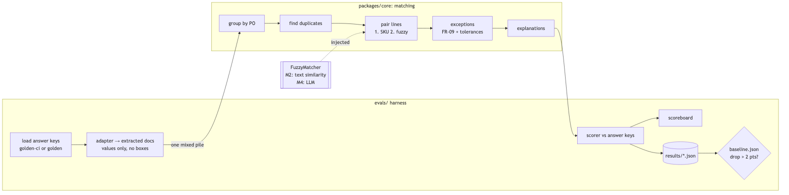
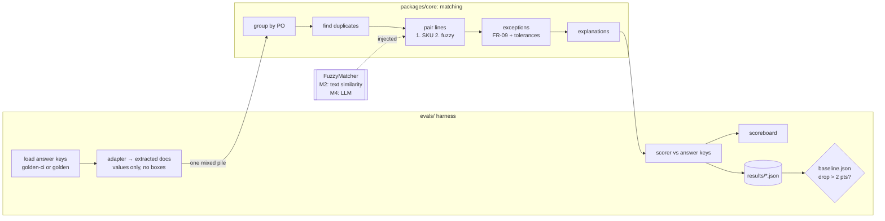

# M2: Matching engine and eval harness. Design

- **Status:** Draft, awaiting approval at the M2 Design gate
- **Implements:** AC-1 … AC-16 from [`requirements.md`](requirements.md)
- **New ADR:** [0009](../../adr/0009-baseline-fuzzy-matcher.md) (non-AI fuzzy matcher)

## 1. Overview



<details><summary>Diagram source (Mermaid)</summary>



</details>

There are three workstreams, built in this order: **(A) matching engine in
`core` → (B) eval harness in `evals/` → (C) generator noise**, followed by docs
and the baseline.

## 2. Matching engine (`packages/core/src/matching/`)

### 2.1 Input: the extracted document (AC-1)

`schemas/extracted.ts` holds the shape M3's LLM extraction will also produce.
It's the answer-key fields **without locations**, plus an id:

```ts
ExtractedDocument = {
  id: string;                      // caller-chosen, e.g. "S0010/inv-1" in evals, a DB id later
  type: 'PO' | 'RR' | 'INVOICE';
  vendorName: string; docNumber: string; poNumber?: string;
  date: string /* ISO */; dueDate?: string;
  lines: { lineNo; sku?; description; qty; uom; unitPrice?; lineTotal? }[];
  subtotal?; tax?; shipping?; total?;   // decimal strings
}
```

`fromTruthDocument(doc, id)` is the adapter (it strips the `page`/`bbox` wrappers).

### 2.2 Public API

```ts
matchDocuments(docs: ExtractedDocument[], opts?: {
  config?: Partial<MatchConfig>;
  fuzzy?: FuzzyMatcher;            // default: textSimilarityMatcher (ADR-0009)
}): MatchResult

MatchResult = {
  groups: {
    poNumber: string;
    documents: { id; role: 'po' | 'rr' | 'invoice' | 'duplicate' }[];
    lineMatches: { po?: LineRef; rr?: LineRef; inv?: LineRef;
                   method: 'SKU' | 'FUZZY'; confidence?: number; reason?: string }[];
    exceptions: { type; lines: LineRef[]; documentIds: string[];
                  amount: string; informational: boolean; explanation: string }[];
  }[];
  unassigned: string[];            // docs with no PO number at all
}
LineRef = { docId: string; lineNo: number }
```

Everything is pure and synchronous in M2. When the LLM matcher arrives (M4), it
will be async. The design keeps `FuzzyMatcher` batch-shaped (`(left[], right[]) →
pairs[]`), so M4 can make it async without changing the pipeline's structure.

### 2.3 Pipeline

1. **Group (AC-2).** The key is the normalized PO number (trim, uppercase,
   spaces removed). A PO uses its own `docNumber`; RRs and invoices use their
   `poNumber`. A group without a PO, or with one but no RR or invoice, is still
   a group. That's how `MISSING_DOCUMENT` gets found.
2. **Duplicates (AC-6).** Within a group's invoices, and globally per vendor:
   same normalized vendor + invoice number, **or** same vendor + same total
   within `duplicateWindowDays` (default 45). The earliest-dated invoice is
   primary, and later ones are marked `duplicate`. A duplicate's lines are never
   matched.
3. **Incomplete set.** If the PO, RR, or primary invoice is missing, emit
   `MISSING_DOCUMENT` only (amount and informational flag per FR-09) and stop.
4. **Pair lines (AC-3).**
   1. *SKU pass:* normalize SKU (uppercase, strip spaces, dashes, dots, and
      leading zeros). Pair PO↔RR and PO↔invoice on exact normalized equality.
   2. *Fuzzy pass:* leftover PO lines vs. leftover invoice lines, and leftover
      PO lines vs. leftover RR lines, go to `fuzzy(left, right)`. Pairs at or above
      `fuzzyThreshold` (default 0.75) are accepted, one-to-one, best score first.
   3. A link's RR↔invoice pair is implied through the shared PO line.
5. **Exceptions (AC-4, AC-5).** For each linked line: `o, r, b, pₒ, pᵢ`. Values
   within tolerance count as equal (see 2.4), then the FR-09 table applies. An
   invoice line with no PO line → `UNMATCHED_LINE` with its line total. A PO
   line never invoiced → `UNMATCHED_LINE`, informational $0. A duplicate →
   `DUPLICATE_INVOICE` with its total.
6. **Explain (AC-7).** One template per exception type, filled with the actual
   numbers (2.5).

This is written **from the PRD**, not by reading `generator/src/truth.ts`. A lint
rule bans `core` and `evals` from importing `@reconcile/generator` (ADR-0008).

### 2.4 Tolerances (AC-5)

```ts
MatchConfig = {
  qtyTolerance:   { abs: 0, pct: 0 },                  // units / fraction of ordered qty
  priceTolerance: { abs: '0.01', pct: '0.005' },       // dollars / fraction of PO price
  duplicateWindowDays: 45,
  fuzzyThreshold: 0.75,
}
```

- **Price:** "equal" when |pᵢ − pₒ| ≤ max(abs, pct × pₒ). Example: a $30.00
  PO price tolerates ±$0.15.
- **Quantity:** "equal" when |a − b| ≤ max(abs, pct × o). The default is exact.
- When values count as equal, the line raises no qty or price exception at all.
  The tolerance boundary itself counts as inside.

### 2.5 Explanation templates

| Type | Example |
|---|---|
| `SHORT_SHIP` | "Ordered 48, received 38, billed 48 at $232.97: billed for 10 units that never arrived ($2,329.70)." / informational: "Ordered 48, received 38; invoice bills only what arrived. No overcharge." |
| `OVER_SHIP` | "Ordered 10, received 12, billed 12 at $5.00: paying for 2 units nobody ordered ($10.00)." |
| `QTY_BILLED_NOT_RECEIVED` | "Received 36, billed 37 at $38.59: billed for 1 unit beyond what arrived ($38.59)." |
| `PRICE_VARIANCE` | "PO price $4.80, invoice $5.00 (+4.2%) on 8 received units ($1.60)." |
| `UNMATCHED_LINE` | "Invoice line 4 (NR-19830, Bean & Cheese Burrito) matches nothing on the PO ($771.80)." |
| `MISSING_DOCUMENT` | "No receiving report for HP-PO-104157: receipt of $4,914.03 invoiced can't be verified." |
| `DUPLICATE_INVOICE` | "Invoice INV-41668 from Tideline arrived twice (2026-03-28 and 2026-04-15); second copy $4,914.03." |

## 3. Baseline fuzzy matcher (ADR-0009)

A small, explainable text-similarity matcher with **no AI and no dependencies**.
It's built from standard string-matching techniques:

1. **Normalize:** lowercase, `&`→`and`, strip punctuation, unify units
   (`fl oz`/`fz`→`floz`, `oz`, `ct`, `pk`), split numbers from letters (`6oz`→`6 oz`).
2. **Token similarity:**
   - **Jaro–Winkler**, which is good with typos ("Lvender" ~ "Lavender").
   - **Abbreviation score:** if one token is a prefix or an in-order subsequence
     of the other and starts with the same letter ("btr" ⊂ "butter", "org" ⊂
     "organic"), the score is ≥ 0.9. That's generic linguistics, **not** the
     generator's abbreviation list.
3. **Line similarity:** symmetric **Monge–Elkan**, where each token takes its
   best match on the other side. Numeric tokens (sizes like "12", "64") must
   match exactly, or the pair is penalized. A size mismatch is a different product.
4. **Tie-breakers:** the same UOM is required. When two candidates are within
   0.02 of each other, the one with the closer quantity wins (a small, explicit
   bonus).
5. **Reason string:** e.g. `text 0.91: "org"≈"organic", "btr"≈"butter"; size 12 oz matches`.

It is deterministic, so the eval scores are reproducible.

## 4. Eval harness (`evals/src/`)

### 4.1 Commands (AC-10, AC-12)

```
pnpm eval                       # CI subset (evals/golden-ci), prints scoreboard, writes results JSON
pnpm eval --subset full         # evals/golden (run `pnpm generate` first)
pnpm eval --check-baseline      # exit 1 if any quality metric drops > 2 points vs evals/baseline.json
pnpm eval --update-baseline     # rewrite evals/baseline.json (commit it with a reason)
```

`--stage` and `--from-ground-truth` are fixed to `match` and on in M2. M3 adds
`--stage extract` and end-to-end.

### 4.2 Flow

1. Load every set's `ground_truth.json`. Make extracted docs with ids like
   `S0010/inv-1` and put **all documents from all sets into one pile**, sorted
   by id. Grouping has to rebuild the sets.
2. Run `matchDocuments(pile)`, timing each group for the latency numbers.
3. Score against the answer keys. Ids carry `setId/role`, so the mapping is exact.

### 4.3 Metric definitions (AC-11)

| Metric | Exactly how |
|---|---|
| **Grouping accuracy** | A document is correct if every other document in its predicted group belongs to its true set and none of its true set is elsewhere. Correct ÷ all documents. |
| **Link P / R / F1** | Expand each line match into pairs `{set, po:3, rr:5}`, `{set, po:3, inv-1:3}`, `{set, rr:5, inv-1:3}`. Precision = correct predicted pairs ÷ predicted; recall = correct ÷ true. |
| **Exception P / R / F1** | Key = `set + type + sorted line keys` (or `+ documents` for missing and duplicate). Precision and recall over keys, overall and **per type**. Informational exceptions are included. |
| **Amount accuracy** | Of correctly keyed exceptions, the share with identical `amount` (to the cent) and `informational` flag |
| **Latency** | p50 / p95 ms per group (reported, not gated) |

Quality metrics are reported on a 0–100 scale. The **gate compares each one
with the baseline and fails if any is more than 2.0 points lower**. A metric can
go up freely. Changing the baseline is a separate, explained commit.

### 4.4 Output

```
Reconcile eval · stage: match · inputs: answer keys · subset: ci (20 sets, 63 docs)

  metric                 score   baseline   change
  grouping accuracy      100.0      100.0     +0.0
  link precision          99.4       99.4     +0.0
  link recall             98.8       98.8     +0.0
  exception precision     95.2       95.2     +0.0
  exception recall        97.6       97.6     +0.0
  amount accuracy        100.0      100.0     +0.0

  per type             TP  FP  FN   P      R
  SHORT_SHIP            4   0   0   100.0  100.0
  ...
  latency  p50 0.4 ms · p95 1.1 ms
  ✓ within 2.0 points of baseline
```

`results/<timestamp>.json` holds the same numbers plus every false positive and
false negative with its explanation, for debugging. The results folder is gitignored.

## 5. Generator: `price_noise` (AC-16)

- Add `price_noise` to the **end** of `PlantedErrorType` and `LINE_ERRORS`. Its
  default rate is 0.15.
- The invoice price becomes pₒ ± k cents, with k ≥ 1 and k ≤ 80% of the default
  tolerance, max($0.01, 0.5% × pₒ). It is always ≥ $0.01 and always inside the tolerance.
- Expected exception: **none**. The answer-key builder treats `price_noise` as noise.
- The generator goes to 0.3.0. Then `pnpm generate:ci` re-picks the subset with
  the extra coverage goal (`price_noise` ≥ 2) and the CI subset is re-committed.
  Appending at the end keeps the random streams for earlier error types
  unchanged, so most existing sets stay identical.

## 6. CI (AC-13)

- A new job, **"Evals (CI subset)"**, runs install, then `pnpm eval --check-baseline`.
  It needs no database.
- After the first green run, it's added to `main`'s required checks.
- **Red-path proof:** a throwaway PR loosens a tolerance (e.g. `fuzzyThreshold:
  0.3`, producing wrong pairings). It shows the eval job failing and is then
  closed without merging. The screenshot or link goes in the test plan.

## 7. Planned commits (`feat/m2-matching-evals`)

1. `feat(core): extracted-document schema and answer-key adapter`
2. `feat(core): normalization and grouping by PO`
3. `feat(core): duplicate invoice detection`
4. `feat(core): SKU line pairing and fuzzy pass`
5. `feat(core): text-similarity fuzzy matcher (ADR-0009)`
6. `feat(core): exceptions with tolerances and explanations`
7. `feat(evals): loader, scorer, scoreboard, results JSON`
8. `feat(evals): baseline check and update`
9. `feat(generator): price_noise planted type; regenerate CI subset (0.3.0)`
10. `chore(evals): commit initial baseline`
11. `ci: evals job`
12. `docs: README eval guide, glossary`

## 8. Risks

| Risk | Mitigation |
|---|---|
| Unconsciously copying the generator's rules makes the matcher "pass" the same bugs | Written from the PRD table. Lint ban on importing the generator. Its own unit tests are written from FR-09 examples. |
| The fuzzy matcher overfits the generator's typo styles | Only generic techniques (no shared abbreviation list). Scores are reported per planted type, so overfitting would show up as suspiciously perfect fuzzy scores. |
| 20 sets give noisy metrics (one miss ≈ 2–5 points) | The gate is measured on the same fixed subset, so it's deterministic, not noisy. A full-set run (100 sets) is reported in the PR for context. |
| A baseline set from a buggy first run locks in bad numbers | The first baseline is reviewed at the Testing gate, with per-type misses listed before committing. |
