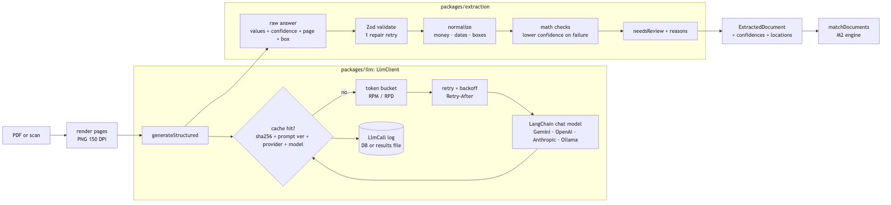
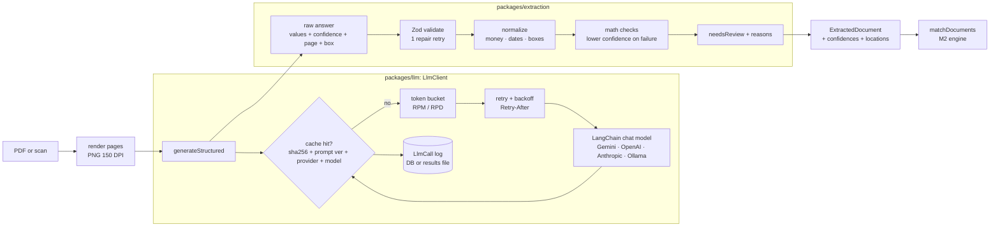

# M3: LLM client and extraction. Design

- **Status:** Draft, awaiting approval at the M3 Design gate
- **Implements:** AC-1 … AC-17 from [`requirements.md`](requirements.md)
- **New ADR:** [0010](../../adr/0010-langchain-provider-switching.md) (LangChain.js for provider switching)

## 1. Overview



<details><summary>Diagram source (Mermaid)</summary>



</details>

Two new packages keep `core` light. `core` keeps only schemas and the matcher.

| Package | Owns |
|---|---|
| `packages/llm` | `LlmClient`: LangChain provider factory, limiter, retry, cache store, cost table, call-log sinks |
| `packages/extraction` | Page rendering, prompt `extract.v1`, the answer schema the LLM fills in, normalization, math checks, review flag, `pnpm extract` CLI |

Dependency direction: `extraction → llm → core`, and `evals → extraction`. The
matcher (`core`) never imports `llm` or `extraction`.

## 2. LLM client (`packages/llm`, ADR-0002 + ADR-0010)

### 2.1 API

```ts
const llm = createLlmClient({ env, cache, sink });   // provider from LLM_PROVIDER
const { data, usage, latencyMs, cacheHit, costUsd } = await llm.generateStructured({
  purpose: 'EXTRACT',
  promptVersion: 'extract.v1',
  model: env.LLM_MODEL_EXTRACT,
  system, user, images: [png1, png2],     // page images
  schema: ExtractionAnswer,               // Zod
  cacheKeyParts: [sha256(fileBytes)],
  documentRef: 'S0010/inv-1',             // for the log
});
```

### 2.2 Providers via LangChain.js (AC-1, ADR-0010)

| `LLM_PROVIDER` | LangChain class | Key / URL env | Status in M3 |
|---|---|---|---|
| `gemini` (default) | `ChatGoogleGenerativeAI` (`@langchain/google-genai`) | `GEMINI_API_KEY` | Live (free tier) |
| `openai` | `ChatOpenAI` (`@langchain/openai`) | `OPENAI_API_KEY` | Mocked HTTP tests |
| `anthropic` | `ChatAnthropic` (`@langchain/anthropic`) | `ANTHROPIC_API_KEY` | Mocked HTTP tests |
| `ollama` | `ChatOllama` (`@langchain/ollama`) | `OLLAMA_BASE_URL` | Mocked; live later as fallback |

- **Calls:** `model.withStructuredOutput(schema, { includeRaw: true })`. The raw
  message gives token usage (`usage_metadata`), and the parsed result is
  validated again by our own Zod schema.
- **Images:** sent as base64 PNG data-URL message parts. Every provider supports
  this, so the input is identical across providers.
- **LangChain's built-in retries are off** (`maxRetries: 0`). Our retry layer owns
  that, so the limiter and the log see every attempt.

### 2.3 Default model and limits

The models were checked against Google's pricing page on 2026-10-17. The
free-tier models include Gemini 3.8 Flash, 3.6 Flash, and 3.5 Flash-Lite.

- **Default:** `LLM_MODEL_EXTRACT=gemini-3.5-flash-lite`. It's the cheapest at list
  price ($0.30 / $2.50 per 1M input/output tokens), and Flash-Lite models usually
  get the largest free quota.
- **Experiment:** the eval records `gemini-3.8-flash` ($0.75 / $3.75) on the CI
  subset too and reports both side by side. If Flash-Lite misses the accuracy
  target, the default becomes Flash, and that's decided with numbers.
- **Free-tier limits** are only published inside AI Studio, so they're settings:
  `LLM_RPM` (default 10) and `LLM_RPD` (default 250). You read your real limits
  in AI Studio and adjust.

### 2.4 Limiter and retry (AC-2)

- **Token bucket** in process: RPM refills continuously, and a day counter
  persists in the cache folder, so a restart doesn't reset the daily budget. The
  call waits for a token. If the *daily* budget is used up, it fails with "daily
  free-tier budget reached; resume tomorrow (cached results are kept)".
- **Retry** on 429, 5xx, or network errors: delay = min(60 s, 2ᵃᵗᵗᵉᵐᵖᵗ s) × random(0.5–1.0),
  or `Retry-After` when present. At most 5 attempts, each logged.

### 2.5 Cache (AC-3)

- **Key:** `sha256(fileBytes) | promptVersion | provider | model`. The stored entry
  holds the parsed answer, token usage, and the **original** latency, so replays
  report the same cost and speed every time (deterministic evals).
- **`FileCacheStore`** writes one JSON file per key. It's used by the CLI
  (`.cache/llm/`, gitignored) and the evals (`evals/cache/`, committed for the CI
  subset).
- A **Postgres cache** comes with the worker in M4 (ADR-0002 planned Postgres; the
  file store is enough for CLI and evals).
- **Prompt lock:** `prompts.lock.json` records `{version → sha256(prompt text)}`.
  A unit test fails if a prompt's text changed but its version didn't.

### 2.6 Cost and call log (AC-4)

- **Price table** (`prices.ts`): list prices per 1M tokens for the Gemini models,
  with the date checked. Unknown models log `costUsd = null` ("price unknown")
  rather than a guess.
- **Sinks:** `PrismaSink` writes `LlmCall` rows (CLI, when `DATABASE_URL` is set).
  `MemorySink` collects calls for the eval results file (CI has no DB). Cache hits
  are logged too, with `cacheHit: true`.

## 3. Extraction (`packages/extraction`)

### 3.1 Pages

PDF pages are rendered with pdfjs and `@napi-rs/canvas` at 150 DPI. PNG and JPEG
files are sent as-is, after a max-dimension check. All pages of a document go in
one call (multi-page tables stay together).

### 3.2 What the LLM must return (`ExtractionAnswer`, AC-5, AC-7)

The schema is compact to save output tokens. Every field is wrapped as
`{ v, c, p, b? }`:

```ts
F<T> = { v: T | null; c: number /* 0-1 */; p: number /* page */; b?: [ymin, xmin, ymax, xmax] /* 0-1000 */ }
ExtractionAnswer = {
  docType: 'PO' | 'RR' | 'INVOICE';
  vendorName: F<string>; docNumber: F<string>; poNumber: F<string>;
  date: F<string /* YYYY-MM-DD */>; dueDate: F<string>;
  lines: { sku: F<string>; description: F<string>; qty: F<number>; uom: F<string>;
           unitPrice: F<string>; lineTotal: F<string> }[];
  subtotal: F<string>; tax: F<string>; shipping: F<string>; total: F<string>;
}
```

- **Money comes back as strings** ("1,234.56" is fine), and we normalize it to
  decimal strings (ADR-0004). It's never a float.
- **Boxes** use Gemini's native `[ymin, xmin, ymax, xmax]` on a 0–1000 scale and are
  converted to our `[x0, y0, x1, y1]` on 0–1.

### 3.3 Prompt `extract.v1`

The system prompt holds the rules: read only what's printed, never correct
typos, convert dates to ISO, use null when absent, one entry per printed line
(keep order), and give confidence honestly. The user part is the page images.
It's stored as a versioned file and locked by hash (2.5).

### 3.4 Validate, check, flag (AC-6, AC-8)

1. Our Zod parse. On failure, **one repair retry** sends the validation errors
   back to the model. If that fails too, the document is `FAILED`.
2. Normalize money, dates, SKU whitespace, and boxes.
3. **Math checks:** qty × unit price = line total (±$0.01); Σ lines = subtotal
   (±$0.02); subtotal + tax + shipping = total (±$0.02); dates are valid. Each
   failure multiplies the confidence of the fields involved by 0.5 and adds a reason.
4. **`needsReview`** when any field's confidence is below `EXTRACT_REVIEW_THRESHOLD`
   (default 0.8) or any check failed, with `reviewReasons` listing them.

Output: `ExtractionResult = { document: ExtractedDocument; confidence: per-field map;
locations: per-field map; needsReview; reviewReasons; llm: { usage, costUsd,
latencyMs, cacheHit } }`.

### 3.5 CLI (AC-9)

```
pnpm extract evals/golden-ci/S0010/inv-1.pdf [--provider gemini] [--model gemini-3.8-flash] [--no-cache]
```

It prints the fields table with confidences, the review reasons, and cost, tokens,
and latency, plus `--json` for raw output.

## 4. Evals

### 4.1 Stages and commands (AC-10, AC-11, AC-14)

```
pnpm eval --stage match            # M2 (perfect inputs), unchanged
pnpm eval --stage extract          # reading accuracy
pnpm eval --stage e2e              # read → match → score
pnpm eval --stage all              # all three (CI)
pnpm eval:record [--model …]       # live run on the CI subset, writes evals/cache/
pnpm eval --replay                 # cache only; a miss fails: "prompt changed: re-record"
```

Without `--replay`, extract and e2e use the cache first, then live calls (the key
must be set).

### 4.2 Extraction metrics (AC-10, AC-12, AC-13)

| Metric | Exactly how |
|---|---|
| **Field P / R / F1** | Compare each predicted non-null field with the answer key. Precision = correct ÷ predicted fields; recall = correct ÷ fields in the answer key. Reported overall, **per field**, and **split by PDF vs. PNG scan**. |
| Equality rules | Money: same decimal value. Dates: same ISO date. Qty: same integer. Text: same after lowercasing and collapsing spaces (punctuation is kept, so a "fixed" typo counts as wrong). SKU and doc numbers: uppercase, spaces removed. |
| **Line alignment** | Predicted lines are aligned to the answer key by an order-preserving best match (dynamic programming on SKU/description/qty agreement). Extra predicted lines count as wrong predictions, and missed lines as missed fields. |
| Document-type accuracy | Predicted `docType` vs. the answer key |
| **Location hit rate** (ungated, Q3) | Of correct fields with a box, the share whose box overlaps the true box with IoU ≥ 0.3 |
| **Review rate** | Documents flagged ÷ all documents |
| **Catch rate** | Of the fields the AI got wrong or missed, the share that were low-confidence or named in the review reasons |
| **Cost and latency** | Tokens, list-price $ and p50/p95 ms, per document and per set. From the cache's recorded values, so replays give identical numbers. |

### 4.3 E2E (AC-11)

Extracted documents keep the answer-key ids (`S0010/inv-1`), go into
`matchDocuments` as one pile, and are scored with the M2 scorer. The scoreboard
shows the `match` (perfect) and `e2e` (AI-read) columns side by side, so the cost
of reading errors is visible.

### 4.4 Baselines per stage (AC-14)

`evals/baseline.json` becomes `{ match: {…}, extract: {…}, e2e: {…} }`, and each
stage is gated by the same 2.0-point rule. Location hit rate, review rate, cost,
and latency are reported but not gated. The CI eval job runs
`pnpm eval --stage all --replay --check-baseline`, with no key needed.

## 5. B-16: harder fuzzy cases (AC-16)

In `build-set`, a `sku_omitted` line now also rewords its invoice description
with probability 0.6. It uses `mutateDescription` (abbreviations, typos), or a
vendor word order ("Sunpeak Almond Butter Crunchy, 12 oz"). The answer key is
unchanged: the lines still belong together and there's no exception. The
generator goes to 0.4.0, and the CI subset is regenerated **before** any LLM
recording (new documents mean new cache keys). The match baseline is
re-recorded, and if it drops below 100, the reason goes in the commit message.

## 6. The user step during implementation

Implementation runs fully on mocks until the live recording step. At that point
I'll pause and ask you to do three things:

1. Open aistudio.google.com, then **Get API key**, then **Create API key**.
2. Add `GEMINI_API_KEY=…` to your own `.env`. **Never paste it in chat.**
3. Note your free-tier limits shown in AI Studio and set `LLM_RPM` / `LLM_RPD` if
   they differ from the defaults.

Then I run `pnpm eval:record`, which takes about 60 calls (one per CI-subset
document) per model.

## 7. Planned commits (`feat/m3-llm-extraction`)

1. `feat(generator): reworded descriptions on SKU-less lines (B-16, 0.4.0)` plus the regenerated CI subset and re-recorded match baseline
2. `feat(llm): package scaffold, env schema, price table`
3. `feat(llm): token-bucket limiter and retry with backoff`
4. `feat(llm): file cache store and prompt lock`
5. `feat(llm): LangChain provider factory (gemini, openai, anthropic, ollama) + mocked tests`
6. `feat(llm): LlmClient with call-log sinks (Prisma, memory)`
7. `feat(extraction): page rendering and ExtractionAnswer schema`
8. `feat(extraction): prompt extract.v1, normalization, math checks, review flag`
9. `feat(extraction): pnpm extract CLI`
10. `feat(evals): extract stage metrics (fields, locations, review, cost)`
11. `feat(evals): e2e stage, replay mode, per-stage baselines`
12. `chore(evals): record CI subset (gemini-3.5-flash-lite, gemini-3.8-flash)` *(needs your key)*
13. `ci: replay all stages`
14. `docs: README extraction and evals, .env.example`

## 8. Risks

| Risk | Mitigation |
|---|---|
| Free-tier quota runs out mid-recording | Daily budget counter. The cache keeps progress; re-running resumes where it stopped. |
| LangChain's structured output for Gemini mishandles nullable or nested schemas | The schema is kept flat-ish. Fallback: `method: 'jsonMode'` plus our Zod parse, which already happens anyway. |
| LangChain version churn | Pinned versions. Everything LangChain-specific lives in one file (the provider factory), so swapping it out touches one file (ADR-0010). |
| Self-reported confidence is meaningless | Math checks adjust it, and the catch rate measures whether flags actually catch errors |
| Flash-Lite accuracy is below target | The two-model comparison decides the default with data |
| Recorded responses go stale when Google updates a model | Replay CI can't see that. Re-record before each release (noted in the release checklist). |
| A key leaks into git | `.env` is gitignored, keys are only read from env, and logs never print headers. A test asserts the results JSON contains no key-like strings. |
