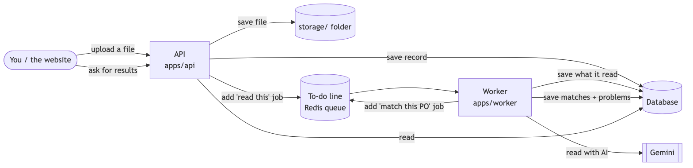
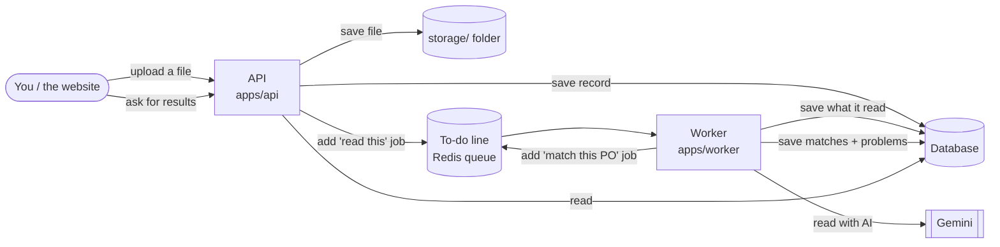

# M4: Upload, background processing, and AI matching. Design

- **Status:** Approved (2026-10-17)
- **Builds:** AC-1 … AC-16 from [`requirements.md`](requirements.md)
- **New decision record:** [ADR-0011](../../adr/0011-api-worker-queue.md) (how the upload service and the background helper work together)

## 1. The big picture



<details><summary>Diagram source (Mermaid)</summary>



</details>

There are **three running pieces**:

| Piece | What it does | Why separate |
|---|---|---|
| **API** (`apps/api`) | Accepts uploads and answers questions ("show me PO 104157") | It must answer in a fraction of a second |
| **Worker** (`apps/worker`) | Does the slow work: reading with AI, matching | AI reading takes ~8 seconds; nobody should wait for it |
| **Queue** (Redis) | A to-do list the API writes to and the worker reads from | If the worker is busy or restarting, jobs wait safely |

Both the API and the worker use one shared toolbox, **`packages/pipeline`**:
saving files, saving results to the database, writing the history log, and the
"read a document" and "match a PO" steps. The rules then live in one place, not two.

## 2. Uploading (AC-1, AC-3)

1. You send a file to `POST /documents`.
2. Reconcile checks it's really a PDF, PNG, or JPEG by looking at the file's
   first bytes (not just its name) and that it's 10 MB or less.
3. It computes the file's **fingerprint** (a *hash*: a short code that's the same
   only for identical files).
   - **Seen before?** It returns the existing document and does nothing else.
   - **New?** It saves the file as `storage/files/<fingerprint>.pdf`, creates the
     document record (status *uploaded*), writes "uploaded" to the history log, and
     adds a **"read this"** job to the queue.
4. You get an answer right away: "received, processing".

## 3. Asking for results (AC-2, AC-3)

| Address | What you get |
|---|---|
| `GET /health` | "I'm alive" (database and queue reachable) |
| `GET /documents` | All documents, newest first, filterable by status and type |
| `GET /documents/:id` | One document: what the AI read, confidence, field positions, review reasons, cost |
| `GET /documents/:id/file` | The original file |
| `GET /sets` | Every PO with its status: *waiting*, *matched*, *needs review* |
| `GET /sets/:poNumber` | One PO: its documents, line matches (with reasons for AI pairs), problems, notes |
| `GET /exceptions` | All problems, filterable by type, status, PO |
| `GET /exceptions/:id` | One problem with its explanation and the lines involved |
| `GET /docs` | The live manual: every address, with a "try it" button |

**How the formats stay correct:** each address's input and output are defined
once (with Zod, the same checking tool we already use). That single definition
checks requests, checks answers, *and* generates the manual, so the three can't
drift apart. Errors always come back in one standard shape, "problem JSON", which
has a title, a status code, and a detail message.

## 4. The worker's two jobs

### 4.1 "Read this document" (AC-4)

1. Mark the document *reading* and log it.
2. Run M3's extraction, with the same AI client, cache, checks, and self-check retry.
3. Save what it read as a **new version** (old versions are kept), including
   confidence, field positions, and review reasons.
4. Fill in the document's details: type, number, vendor (matched by name to our
   vendor list), and which PO it belongs to.
5. Mark it **ready** or **needs review**. If the AI keeps failing after 3 tries, mark it **failed**.
6. Add a **"match this PO"** job.

**No double work:** the job's name *is* the file's fingerprint, so the queue
refuses a second identical job. Quota or budget errors stop retrying immediately,
because waiting won't fix them.

### 4.2 "Match this PO" (AC-5, AC-6, AC-14, AC-16)

1. Collect the PO's documents and that vendor's other invoices (to catch
   duplicates across POs).
2. Run the matcher (M2), with the chosen fuzzy matcher (§5).
3. **Misread PO numbers (B-17):** if a document points to a PO that doesn't exist,
   and a real PO from the same vendor is **one character different**
   (`HP-PO-10793` vs `HP-PO-107093`), group them and add a note: "Receiving report
   says HP-PO-10793; grouped with HP-PO-107093 (1 character apart)". The PO is
   labeled *needs review*.
4. **Patience (grace period):** if a document is missing and the newest document
   arrived less than 7 days ago, don't raise "missing document" yet. Label the PO
   *waiting*, and schedule a re-check for when the 7 days are up.
5. Save the result as a **new match version** (old ones are kept).
6. **Decisions carry over:** every problem gets a fingerprint (its type, plus the
   PO, plus the exact lines). If the previous version had the same problem and a
   human already decided on it, the decision is copied forward.
7. **Provisional label:** if any document in the PO was flagged for review, or a
   note was added in step 3, the PO is marked *provisional, needs review*.
8. Log every step in the history.

**Bursts of uploads:** if 3 documents of one PO arrive within seconds, the queue
merges the "match" jobs into one (a short wait called *debounce*), so the PO is
matched once, not three times.

### 4.3 Staying under the AI's speed limits (AC-7)

Today the speed-limit counter lives inside one program. With several workers, each
would count separately and together they'd go over. So the counter moves into
**Redis**, which all workers share. The AI client already accepts a pluggable
limiter, so this is a new limiter, not a rewrite.

### 4.4 History log (AC-8)

Each step writes its history entry **in the same database transaction** as the
change itself. Either both are saved or neither is, so the history can't miss a
step or describe something that didn't happen.

## 5. The AI matcher, and keeping it honest (AC-9, AC-10, AC-15)

### Three ways to pair tricky lines

| Strategy | How |
|---|---|
| `text` (today) | The word-similarity matcher only |
| `llm` | The AI pairs all leftover lines |
| `hybrid` | Text matcher first; the AI only for lines it still couldn't pair |

**The AI's job:** it gets two short lists (leftover PO lines and leftover invoice
lines) and returns pairs, each with a confidence and a **reason**, for example
"'Nut Spread, Chunky' is the vendor's name for Crunchy Almond Butter; same 12 oz
size". It uses its own versioned prompt (`fuzzy.v1`) and the same cache, speed
limits, cost tracking, and replay as document reading. Sizes and units must still
match: the AI can't pair a 12 oz with a 16 oz.

### Harder test cases (AC-15)

There's a new kind of planted error, **"vendor name"**: the invoice line has no SKU
and uses the vendor's own words. Examples:

| Our catalog | The invoice says |
|---|---|
| Sunpeak Crunchy Almond Butter, 12 oz | Sunpeak Nut Spread, Chunky Almond, 12 oz |
| Brookcrest Unsweetened Oat Milk, 32 fl oz | Brookcrest Oat Drink, No Sugar Added, 32 fl oz |
| Greenvale Sea Salt Kettle Chips, 5 oz | Greenvale Kettle-Cooked Crisps, Salted, 5 oz |

Each product gets 1–2 hand-written vendor names that a person would recognize. The
generator goes to 0.5.0, and the 20 test sets are regenerated so they include
these lines.

### Choosing with data

`pnpm eval --fuzzy text|llm|hybrid` runs the same sets three ways and shows the
scores, cost, and speed side by side. The default becomes whichever wins. If
`text` still wins, we keep it and say so.

## 6. Proving it all works (AC-11, AC-12)

- **Full test (AC-11):** start the API and a worker inside the test, upload one
  document set, wait until the PO is matched, then ask the API for the problems and
  compare with the answer key. The AI part uses **saved answers** (replay), so no
  key and no cost. CI gets a Redis service next to Postgres for this.
- **The scoreboard tells the truth (AC-12):** a script uploads all 20 test sets
  through the real API and worker (grace period set to 0), collects the problems
  from the API, and checks they're **the same** as the scoreboard's `e2e` stage:
  each problem's PO, type, amount, and whether it's informational.

## 7. Database changes

| Table | Change | Why |
|---|---|---|
| `DocumentSet` | add `status` (waiting / matched / needs review), `provisional`, `notes` | AC-6, AC-14, AC-16 |
| `Extraction` | add `reviewReasons`, `locations`, `needsReview` | Show why a document needs a look, and where each field is |
| `Exception` | add `carriedOverFromId` | Shows a decision was copied from an earlier version |

## 8. Running it

```bash
docker compose up -d     # database + Redis
pnpm dev                 # starts the API (port 3001) and the worker together
curl -F file=@evals/golden-ci/S0010/inv-1.pdf localhost:3001/documents
open http://localhost:3001/docs
```

## 9. Planned commits

1. `feat(core): tolerant PO grouping (B-17)` + tests
2. `feat(core): async fuzzy matchers` (so the AI can plug in)
3. `feat(db): set status, extraction review fields, carried-over exceptions` (migration)
4. `feat(pipeline): storage, document and set repositories, audit helper`
5. `feat(pipeline): read-document and match-PO steps (grace period, carry-over, provisional)`
6. `feat(llm): Redis-shared rate limiter`
7. `feat(api): upload + read endpoints, problem JSON, OpenAPI manual`
8. `feat(worker): queues, jobs, debounce, delayed grace re-checks`
9. `feat(generator): vendor-name planted type (0.5.0)` + regenerated test sets
10. `feat(extraction): AI fuzzy matcher (fuzzy.v1)` + `eval --fuzzy`
11. `chore(evals): record AI matcher answers; baselines`
12. `test: full pipeline test; pipeline = eval check; CI Redis service`
13. `docs: README for running the stack`

## 10. Risks, and what we'll do about them

| Risk | What we'll do |
|---|---|
| Regenerating the test sets (for vendor names) invalidates the saved AI reading answers | Re-record once (about 15 minutes, free). The cache only re-reads documents that changed. |
| The AI matcher's free quota is small | It only runs on leftover lines (few per PO), with one call per PO |
| Two workers grab the same job | The queue's job names are unique (the file fingerprint, or `match:<PO>`) |
| A crash halfway through a job | Each save happens in one transaction, and jobs are safe to run again |
| Tests that need Redis and Postgres are slow or flaky | One full-pipeline test plus a replay check. Everything else stays fast unit tests. |

## 11. What changed while building (implementation notes)

| Planned | What we did | Why |
|---|---|---|
| Vendor names keep the brand ("Sunpeak Nut Spread…") | The vendor names drop the brand and lead with the variant ("Chunky Nut Spread, Almond, 12 oz") | With the brand kept, the word matcher still scored 100, so the test showed nothing. Real vendor invoices rarely repeat their own brand. |
| Pick the AI matcher's role by data | **Hybrid** won: 100 on the CI subset (text: 89.5) and 98.3 on 200 stress sets (text: 96.8), with 1–2 AI calls | The AI only sees what the word matcher isn't sure about: cheap, explainable, deterministic where possible |
| A matcher that answers synchronously | `matchDocuments` became asynchronous | So the AI matcher can plug in without the rest of the code changing |
| The misread-PO fix inside one batch | The worker also looks at the same vendor's PO sets one character away | In the running system, a misread number creates a separate PO set |
| (not planned) | An AI answer that stops early now keeps its complete part | Seen live: a reply ended at `"total":{`. The checks flag the missing part for review. |
| (not planned) | The scorer's own tests build their "perfect" answer from the answer keys | They used the word matcher as "perfect", which stopped being true with vendor names. A commit briefly went out with 4 failing tests and was fixed right after. |
