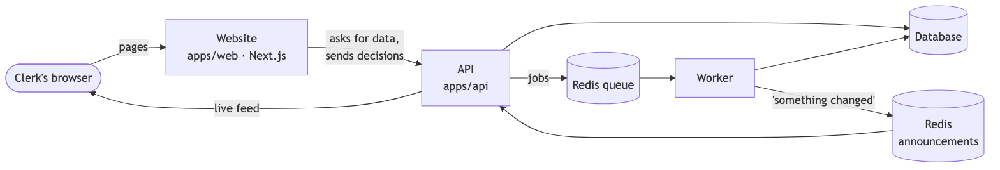
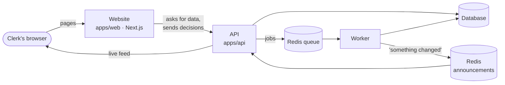

# M5: The website. Design

- **Status:** Approved (2026-10-17)
- **Builds:** AC-1 … AC-13 from [`requirements.md`](requirements.md)
- **New decision records:** [ADR-0012](../../adr/0012-website-stack.md) (how the website is
  built) and [ADR-0013](../../adr/0013-live-updates.md) (how live updates reach the browser)
- **Look and feel:** [style guide](../../style-guide.md) and the clickable mockup
  ([open it online](https://claude.ai/artifact/H6iaQF9U43dZXch8vdLfb8), source in [`mockup/index.html`](mockup/index.html))

## 1. The big picture

Diagram source (Mermaid)

The website is a **fourth running piece**, next to the API, the worker, and Redis. It
never touches the database itself: it only talks to the API, exactly like any other
client would. That keeps all the rules (who can change what, what gets logged) in one place.

**Live updates (AC-3):** when the worker finishes a step, it posts a short announcement
("document X is now *ready*") on a Redis channel. The API listens to that channel and
passes each announcement down an open connection to every browser that's watching. The
page then refreshes just the part that changed. Details in ADR-0013.

## 2. The pages

| Page | Address | Main pieces | ACs |
|---|---|---|---|
| Overview | `/` | Money at risk (large figure), problems by type (small bar list), PO status counts, AI cost and speed per document, recent activity | AC-7 |
| Problems | `/problems` | A list sorted by dollar impact on the left; the selected problem on the right: explanation, a **three-column line comparison** (PO · receipt · invoice) with differences highlighted, and the decision panel | AC-1, AC-5 |
| POs | `/pos` and `/pos/[po]` | A table of POs with status; one PO shows documents, line matches (how each was paired, with the AI's reason), problems, notes, and the **history timeline** | AC-6 |
| Document | `/documents/[id]` | The page image with a box over every field the AI read; next to it, the fields with confidence. Hover a field to light up its box. Unsure fields get an amber mark and an "Edit" button. | AC-2, AC-4 |
| Review | `/review` | Documents waiting for a human check, each with its reasons ("totals don't add up") | AC-2 |
| Upload | `/upload` | A drop zone; each file becomes a row that moves through *uploaded → reading → ready → matched* live | AC-3 |

A **side bar** holds the logo, the six pages (with live counts), and the signed-in user
(the one built-in user). A **command bar** (press `/`) jumps to any PO or document number.

### The decision flow (AC-1)

1. The clerk picks **Approve**, **Dispute**, or **Write off** (or presses `A`, `D`, `W`).
2. A note box opens. It's required: the button stays visible but explains "Add a note
   first" if it's empty.
3. On save, the problem leaves the open list at once (an *optimistic update*: the screen
   changes before the server answers, and changes back with a message if it fails), and
   the next problem is selected.
4. The API saves the decision and the history entry in one transaction.

### Correcting a field (AC-2)

1. On the document page, the clerk clicks **Edit** next to a field and types the right value.
2. The API saves a **new version** of what the document says, marked *human* (the AI's
   version stays). It re-runs the math checks, so the clerk is told if the totals still
   don't add up.
3. The document becomes *ready* and a "match this PO" job is queued. The page shows
   "Re-matching…" until the live feed says the PO was matched, then the problem list
   refreshes.

## 3. API changes

| Address | What it does | ACs |
|---|---|---|
| `POST /exceptions/:id/decision` | Body: `{ action: APPROVE \| DISPUTE \| WRITE_OFF, note }`. The note can't be empty. A problem that's already decided, or not in the PO's latest match, is refused with a clear message. | AC-1 |
| `POST /documents/:id/corrections` | Body: `{ fields: { "total": "1284.50", "lines.2.qty": 12 } }`. Saves a human version, re-checks, queues a re-match. | AC-2 |
| `GET /documents/:id/pages/:n` | The page as a PNG image (PDFs are drawn on the server once, then kept in storage) | AC-4 |
| `GET /exceptions/:id` | Now also returns the **lines involved** from each document (description, SKU, qty, price), so the side-by-side view needs one call | AC-5 |
| `GET /exceptions?sort=impact` | Largest dollar impact first | AC-5 |
| `GET /sets/:po/history` | Every history entry for the PO, its documents, and its problems, oldest first, with the person's name for human actions | AC-6 |
| `GET /overview` | The overview numbers (money at risk, counts, cost and speed per document, last 10 events) | AC-7 |
| `GET /events` | The live feed (server-sent events: a connection the server keeps open and writes small messages to) | AC-3 |
| `GET /me` | The built-in user's name, for the corner of the screen | – |

**No database changes are needed.** The tables for decisions (`ExceptionActionRecord`),
versioned readings (`Extraction` with `source = HUMAN`), and history (`AuditEvent`)
already exist from M1 and M4.

**Keeping the website's types in sync:** the website's API client is **generated from
the API's own manual** (the OpenAPI file at `/docs/json`). If an API answer changes
shape, the website stops type-checking instead of breaking quietly.

## 4. Look and feel (AC-8, AC-9, AC-10)

The "Ledger" look is written down in [`docs/style-guide.md`](../../style-guide.md). In short:

- **Paper and ink.** A warm off-white page, near-black ink, thin ruled lines like an
  accounting ledger. One deep teal accent for actions and links.
- **Three typefaces, each with one job.** *Newsreader* (a serif) for page titles and
  the big numbers, *Inter* for everything else, with figures set to equal width so
  columns of money line up, and *IBM Plex Mono* for document numbers and SKUs.
  All are free (open font license), installed as packages so builds need no internet.
- **Color means something.** Brick red = money at risk or disputed, ochre = needs a look,
  moss green = resolved. Never color alone: each also has an icon or a word.
- **A logo mark:** three short rules (PO, receipt, invoice) closing into a check.
- **Both themes finished:** dark mode is "ink on slate", designed, not inverted.
- **Keyboard:** `J`/`K` next/previous, `A`/`D`/`W` decide, `E` edit field, `/` search,
  `G` then `O`/`P`/`U` to jump between pages, `?` shows all shortcuts.
- **States:** shaped loading placeholders (*skeletons*) instead of spinners; empty
  states that say what to do next; errors that say what happened and offer "Try again".

## 5. Technology (ADR-0012)

| Need | Choice | Why |
|---|---|---|
| Framework | **Next.js 16** (App Router) | The plan named it; the industry standard for React apps |
| Styling | **Plain CSS with design tokens** (CSS variables) and CSS Modules | Full control of the look; no "default library" feel |
| Accessible building blocks | **Radix UI primitives** (unstyled dialogs, menus, tooltips) | Keyboard and screen-reader behavior done right, styled by us |
| Data loading | **TanStack Query** in the browser | Caching, background refresh, optimistic updates; live events tell it what to refresh |
| API client | **openapi-typescript + openapi-fetch** | Types generated from the API manual (§3) |
| Page images | Drawn on the server (pdfjs + canvas, which we already use) | One plain image per page makes the highlight boxes simple and fast |
| Checks | Vitest for logic and components, **Playwright** for the one browser test, **axe** for accessibility | Matches the testing rules in CLAUDE.md |

## 6. Proving it (AC-11, AC-12)

- **The one browser test (AC-12):** Playwright starts the API, worker, and website in
  replay mode (saved AI answers, no key). It uploads one test set, waits for *matched*,
  opens the costliest problem, writes it off with a note, and finds that decision in the
  PO's history. While it moves through the pages, **axe** checks each one for serious
  accessibility problems. It runs in CI as a new required check.
- **Speed and accessibility scores (AC-11):** Lighthouse runs by hand on the main pages
  in the Testing phase; the scores go in the test plan.

## 7. Planned commits

1. `docs: style guide and clickable mockup` (this phase)
2. `feat(api): decision, correction, history, overview, me endpoints` + tests
3. `feat(pipeline): page images` + `feat(api): GET /documents/:id/pages/:n`
4. `feat(pipeline,api): live events over Redis and SSE` + tests
5. `feat(web): Next.js app, tokens, fonts, layout, side bar, themes`
6. `feat(web): overview`
7. `feat(web): problems queue and decision flow`
8. `feat(web): PO detail and history timeline`
9. `feat(web): document viewer with highlights and corrections`
10. `feat(web): review and upload pages`
11. `feat(web): keyboard shortcuts and command bar`
12. `test(e2e): Playwright happy path with axe; CI job`
13. `docs: README with screenshots`

## 8. Risks, and what we'll do about them

| Risk | What we'll do |
|---|---|
| "Polished" eats the whole schedule | The style guide and mockup are approved *first*; pages reuse a small set of components |
| AI boxes are sometimes missing or a bit off | Fields without a box still show in the list; boxes get a little padding; the test sets let us measure how often boxes are missing |
| The live connection drops (laptop sleeps, server restarts) | The browser reconnects by itself and refreshes everything once when it does |
| The browser test is slow or flaky in CI | One test only, replayed AI, grace period 0, and it waits for real signals (status text), never fixed sleeps |
| A human correction makes the PO worse (typo) | The math checks re-run and warn; the AI's version is kept, so the history shows both |
| Two tabs decide the same problem | The API refuses a decision on an already-decided problem, and the second tab shows who decided it |
