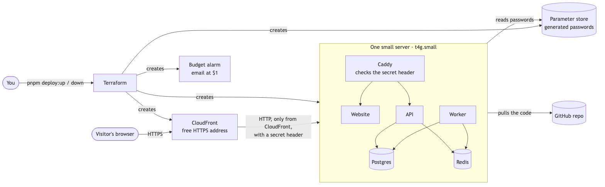
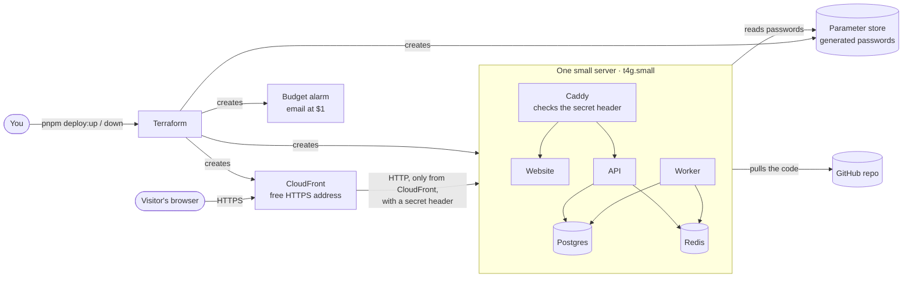

# M7: Deploy to AWS. Design

- **Status:** Draft, waiting for your approval
- **Builds:** AC-1 … AC-13 from [`requirements.md`](requirements.md)
- **New decision records:** [ADR-0015](../../adr/0015-one-server-behind-cloudfront.md) (one small
  server behind CloudFront) and [ADR-0016](../../adr/0016-demo-password-for-changes.md) (a shared
  demo password for changes)

## 1. The big picture

Diagram source (Mermaid)

- **One small server** runs the same containers as your laptop: Postgres, Redis, API, worker, and
  website, plus **Caddy**, a small web server that routes `/api` to the API and everything else to
  the website.
- **CloudFront** (AWS's content-delivery service, part of the always-free offer) gives the site an
  HTTPS address like `d1abc23xyz.cloudfront.net` without buying a domain.
- The server accepts web traffic **only from CloudFront**, and only with a secret header CloudFront
  adds, so nobody can go around CloudFront.
- **No remote-login port is open.** Administration uses AWS Session Manager (a browser or terminal
  session through AWS), which needs no open port and no SSH key.

## 2. What gets created, and what it costs

All in one AWS region (`us-east-1`), tagged `Project=reconcile` so the teardown check can find
anything left over.

| Resource | Why | Expected cost (paid from the Free plan credits) |
|---|---|---|
| EC2 `t4g.small` (2 vCPU, 2 GB memory, ARM) | Runs everything; on the Free plan's allowed list | about $12.30 a month |
| 20 GB disk (gp3) | Code, containers, database, uploads | about $1.60 a month |
| Public IPv4 address | The server's address (CloudFront connects to it) | about $3.65 a month |
| CloudFront distribution | HTTPS address | $0 (always free: 1 TB and 10 million requests a month) |
| Security group, IAM role, Session Manager | Firewall, server permissions, admin access | $0 |
| Parameter store (standard tier) | Generated passwords | $0 |
| AWS Budget with email alerts | Cost alarm | $0 (the first two budgets are free) |
| **Total** | | **about $17.50 a month**: $100 of credits lasts about 5.5 months, $200 covers the full 6 |

**Deliberately not used** (the usual surprise costs): a managed database (RDS), a load balancer, a
NAT gateway, CloudWatch log storage, and ECR (an image registry). On a Free-plan account none of
these could bill you anyway, but they'd burn the credits much faster.

## 3. Deploying and updating (AC-1, AC-3)

`pnpm deploy:up` runs `scripts/deploy.ts`, which:

1. Checks the tools and your sign-in (`terraform`, `aws`, `aws sts get-caller-identity`), and that
   the commit being deployed is pushed to GitHub (the server pulls code from there).
2. Runs `terraform apply` in `infra/`, passing the commit and your budget-alert email.
3. Waits for the server to be ready, then uses **Session Manager's run-command** to run
   `deploy/update.sh <commit>` on it.
4. Runs the live smoke test (§7) and prints the link and the demo password.

On the server, `update.sh`:
- fetches the commit from GitHub, builds the containers (with 2 GB of swap so the website build fits
  in memory), runs the database migrations as the **owner** user, applies the app user's
  permissions (§5), and restarts the containers with `docker compose up -d`;
- loads the demo data the first time (the 20 CI test sets, read with the recorded AI answers), so
  the site opens with real problems to look at.

The **first boot** (cloud-init, the server's setup script) installs Docker and Git, adds the swap
file, reads the generated passwords from the parameter store into a `.env` file only root can read,
and clones the repository.

Running `pnpm deploy:up` again with nothing changed makes Terraform report "no changes" and leaves
the running containers as they are; with a new commit, only the containers are rebuilt. The
database lives on the server's disk, so decisions survive updates.

## 4. Tearing down (AC-2)

`pnpm deploy:down` runs `terraform destroy`, then a **leftovers check** using the AWS command-line
tool: no instances, disks, public addresses, CloudFront distributions, or parameters tagged
`Project=reconcile` may remain. It prints "Nothing billable is left" or lists what it found.

## 5. Safety

### The demo password (AC-8, ADR-0016)
- When `DEMO_PASSWORD` is set (only in the cloud), the API refuses every **change** (upload,
  decision, correction) unless the browser has unlocked changes. Reading is open to everyone.
- The website gets an **Unlock changes** button: you enter the password once, the API checks it and
  sets a signed, HTTP-only cookie (the browser keeps it; page scripts can't read it).
- A locked change gets a clear "Changes are locked on this demo. Unlock them with the demo password."
  message, and the website opens the unlock dialog.
- Locally, `DEMO_PASSWORD` isn't set, so nothing changes for development.

### Secrets (AC-9)
- Terraform generates random passwords (database owner, app user, demo password, CloudFront secret
  header, cookie-signing key) and stores them as encrypted parameters in the parameter store.
- The server reads them at boot through its own permission (an IAM role that can only read
  `/reconcile/*`). Nothing secret is in the repo, the Terraform files, or the container logs.
- Terraform's state file (its record of what it created) contains those generated values, so it
  stays on your computer, ignored by Git.

### The audit log, part 2 (AC-10, ADR-0005)
- Migrations run as the database **owner**. The app (API and worker) connects as a separate
  **app user** that may read and write the normal tables but may only `SELECT` and `INSERT` on
  `AuditEvent`: no `UPDATE`, no `DELETE`. The existing trigger stays as a second lock.
- The permissions live in a SQL script (`packages/db/sql/app-role.sql`) that `update.sh` applies
  after each migration, and a database test proves an update is refused by **permissions**, not just
  by the trigger.

### Demo mode for the AI (AC-6)
- The cloud runs with recorded AI answers only (`LLM_MODE=replay`); no AI key exists in AWS.
- A document that isn't one of the recorded test files is marked "couldn't read" with the message
  "Demo mode: this site only reads the sample documents. Run Reconcile locally to read your own."
  instead of today's developer-oriented error, and the upload page shows that message.

## 6. Code and file layout

| Path | What |
|---|---|
| `infra/` | Terraform: `main.tf` (server, security group, role), `cdn.tf` (CloudFront), `secrets.tf`, `budget.tf`, `variables.tf`, `outputs.tf`, `versions.tf` (Terraform 1.16, AWS provider 6.x, random 3.x, pinned) |
| `deploy/` | `cloud-init.yaml`, `update.sh`, `docker-compose.prod.yml`, `Caddyfile`, `Dockerfile` (one image for API, worker, and website) |
| `scripts/deploy.ts` | `deploy:up`, `deploy:down`, and the leftovers check |
| `packages/db/sql/app-role.sql` | The app user's permissions (+ test) |
| `apps/api` | The demo-password gate and `POST /demo/unlock` |
| `apps/web` | The Unlock changes button and dialog; locked-change handling |
| `apps/worker` | The demo-mode message for unrecorded documents |
| `apps/web/e2e/live-smoke.spec.ts` | The live smoke test (§7) |

## 7. Proving it (AC-11, AC-12)

- **Live smoke test:** a Playwright test with its own config (no local servers) that opens the live
  link, checks the overview and problems load, unlocks changes with the demo password, writes off a
  problem with a note, and finds it in the history. `pnpm deploy:up` runs it at the end;
  `pnpm deploy:smoke` runs it on its own.
- **CI:** a new job runs `terraform fmt -check` and `terraform validate` (no AWS access, no
  credentials), plus `shellcheck` on the deploy scripts.
- **Local tests:** the demo-password gate (API tests), the app user's permissions (database test),
  and the demo-mode message (worker test) all run in the normal `pnpm test`.

## 8. Before the first deploy (you)

These steps are yours, because they involve your account and credentials:

1. Create an AWS account and choose the **Free plan**.
2. Install the AWS command-line tool and Terraform (`brew install awscli hashicorp/tap/terraform`).
3. Sign in from your terminal (`aws login`, or `aws configure sso`). Terraform uses that sign-in; no
   keys go in the repo or the chat.
4. Run `pnpm deploy:up`.

## 9. Planned commits

1. `feat(db): app database user without history edits` + test
2. `feat(api,web): demo password for changes` + tests
3. `feat(worker): demo-mode message for unrecorded documents` + test
4. `feat(deploy): Dockerfile, production compose, Caddy, server scripts`
5. `feat(infra): Terraform for the server, CloudFront, secrets, budget`
6. `feat(scripts): deploy:up, deploy:down, leftovers check`
7. `test(e2e): live smoke test`; `ci: Terraform and shell checks`
8. `docs: README deploy guide`

## 10. Risks, and what we'll do about them

| Risk | What we'll do |
|---|---|
| The website build runs out of memory on a 2 GB server | 2 GB swap file; if still too slow, build the image on your Mac (also ARM) and copy it over Session Manager |
| CloudFront cuts the live-updates connection | No caching for `/api`, the 25-second heartbeat stays under CloudFront's 30-second limit, and the browser already reconnects |
| A stranger finds the server's own address | It only answers CloudFront's address range, and only with the secret header |
| Credits run out or the plan ends | Budget alarm at $1; the README says when credits will run out; `deploy:down` removes everything |
| I can't test against AWS without your account | Everything that can run locally is tested locally (containers, Caddy, scripts in a local Docker run); the first real deploy is a guided step in the Testing phase |
| A forgotten resource keeps costing money | Everything is tagged; the leftovers check runs after every teardown |
